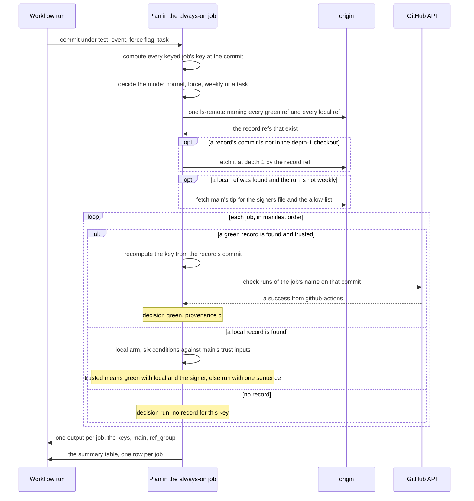
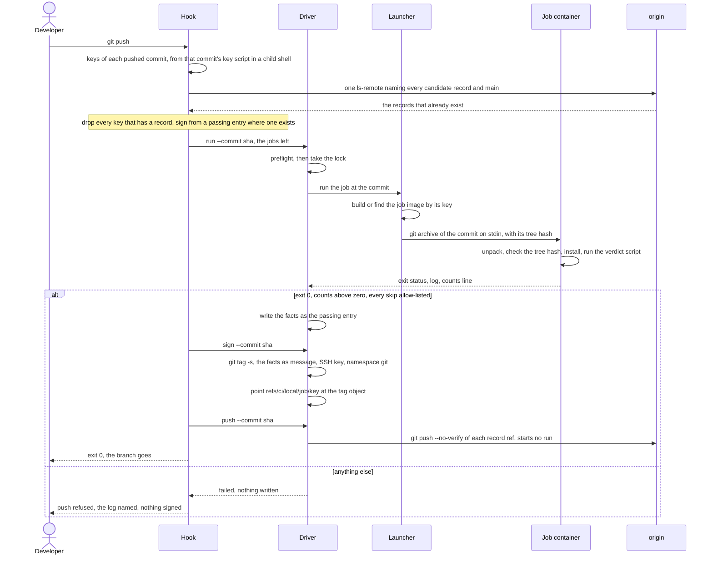
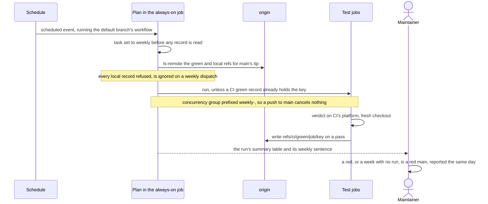

# Design: signed workstation test runs that CI trusts

```text
        .-"""-.    ?
       / .===. \  /
       \/ 6 6 \/-'       why each control exists,
       ( \___/ )         and what it does not promise
  ___ooo__V__ooo___
```

This document is the reference for the scheme quokka-ci-kit implements: why it exists, what each record proves, every control on trust and the reason for it, and what an adopter must build, prove and decide. The command and manifest reference is [`kit/README.md`](kit/README.md); the front page is [`README.md`](README.md).

## How to read this document

The scheme fits any repository that tests on a hosted, per-minute-billed CI service and whose developers can run the same tests on their own machines. The generic text is the specification. Two kinds of paragraph sit beside it:

- **In the kit:** how quokka-ci-kit realises the rule: its file names, its manifest directives, its exact sentences. Where the generic text says "the key script", the kit has a library and a manifest; where it says "the driver", the kit has `ci/kit/bin/local-ci`.
- **In the example:** the values the example adopter, [`quokka-ci-kit-example`](https://github.com/aames/quokka-ci-kit-example), chose. It is a small project, `rottnest`, that records quokka sightings on Rottnest Island: a Go API with a Postgres database and a web front end tested with vitest. It is one project's choices, never a requirement.

Where a value must be chosen per project the text says so, and §11 collects every such choice in one table. Terms are defined in §2 and used exactly thereafter. Files are named by role in the generic text (the key script, the plan, the verdict script, the driver, the launcher, the hook, the signers file); §13 maps each role to the kit's file and the example's.

You are assumed to know git (refs, objects, hooks), POSIX shell, Docker, and the CI service's job model (jobs and steps, `needs` and `if`, check runs, branch protection). Everything the scheme needs beyond those is stated where it is used.

## 1. The problem and the idea

### 1.1 The problem

Hosted CI bills by the job-minute and runs every job on every push. In a repository with a few heavy test suites, most of those runs re-test trees whose tests you ran minutes earlier on a workstation that is often faster than the runner, and many re-test trees that did not change at all: a documentation commit, a merge commit, a rebase of an untouched branch. The minutes are spent re-proving what is already known, and when the month's allowance runs out, nothing runs.

### 1.2 The idea, in three moves

1. **A verdict belongs to a tree, not to a commit.** Every test job is given a KEY: a hash of exactly the content its verdict depends on, taken at the commit under test. Two commits whose relevant content is identical have the same key, so a pass for one is a pass for the other.
2. **A pass is recorded under its key, and a later run with the same key skips the job.** When a job passes, CI writes a RECORD named by the job and the key. The first steps of every run compute the keys, look the records up, and tell each job whether to run. A skipped job bills nothing. This move alone removes the re-runs of documentation commits, merge commits and untouched trees.
3. **The workstation may write a record too, signed, and CI trusts it under a strict check.** A pre-push hook runs the job's own script on the commit being pushed, inside a job image built from that commit (the same image CI runs), and when the script passes, the hook signs a block of facts about the run with your SSH key and pushes it as a record under a separate namespace. CI's plan trusts that record only when the signature verifies against a list of signers held on the protected main branch and the facts pass several checks. The trust is bounded by one scheduled run a week that ignores every local record and runs on CI's own platform every job whose key at main's tip CI has not itself passed.

The first two moves are LAYER ONE, green by content (§5). The third is LAYER TWO, local evidence (§6). Layer one stands on its own and is built first.

### 1.3 The flow, end to end

```
developer            workstation (hook, driver)                       git host                 CI (plan, jobs)
   |
   | git push --------> 1. compute each pushed commit's keys
   |                    2. ls-remote: which keys already have a record? ------> answers
   |                    3. for the rest: run the job's verdict script on the
   |                       commit, inside the job image, in isolation
   |                    4. each pass: write the facts, sign a tag object with
   |                       the developer's SSH key, push it as
   |                       refs/ci/local/<job>/<key> ---------------------------> (starts no run)
   |                    5. push the branch -------------------------------------> run starts
   |                                                                        (through the branch's open pull request)
   |                                                                                 |
   |                                                                  plan: compute keys, ls-remote the
   |                                                                  record refs, trust-check every hit,
   |                                                                  decide run or green per job, write
   |                                                                  the summary table
   |                                                                                 |
   |                                                                  skipped job: bills nothing; the
   |                                                                  summary says which record it rests
   |                                                                  on (ci, or local: <signer>)
   |                                                                  job that runs and passes: writes
   |                                                                  refs/ci/green/<job>/<key>
   |
   |            once a week, on a schedule: the same workflow ignores every local
   |            record, runs on CI each job main's tip has no CI green record for,
   |            and writes green records.
```

A push to a branch starts a run only through that branch's open pull request (its `synchronize` event); with none open, the records the hook pushed wait on the remote, and the run that opening the pull request starts finds them by key (§5.6).

### 1.4 What it changes for the people

You push as before. The first push of a changed tree runs the tests on your workstation first (a few minutes) and then pushes; a push of an untouched or already-tested tree runs nothing and goes at once. The pull request's run skips every job that has a record and shows, in its summary, which record each skip rests on. `--no-verify` still works and is the safe default: the branch arrives without records and CI runs everything, as it always did.

## 2. Vocabulary

Each term below is used exactly as defined.

- **Job.** A CI job whose outcome is a pass or fail verdict over content: a test job. A job that produces an artefact (a build) may carry a record of its own kind but is not a test job here. The ALWAYS-ON JOB is the one job that runs on every run regardless; it hosts the plan.
- **Tree, or content.** The set of repository paths whose content decides a job's verdict. Not the whole repository unless the job reads the whole repository.
- **Key.** A 64-character lower-case hexadecimal SHA-256 over a job's path list at a commit, under a version string (§5.1). Equal keys mean equal content for that job.
- **Record.** A git ref under `refs/ci/` whose name carries the job and the key, pointing at an object that identifies the commit tested. Two kinds: a GREEN RECORD, written by CI, is a ref to an unsigned annotated tag object whose target is the commit (a record written before the green facts block existed is a lightweight ref to the commit, and is still trusted); a LOCAL RECORD, written by a workstation, is a ref to a signed annotated tag object whose target is the commit.
- **The plan.** The first steps of the always-on job: compute keys, look records up, trust-check each hit, output one decision per job, write the summary table (§5.3).
- **The verdict script.** One script in the repository, taking the job name, that holds every check deciding that job's verdict; CI runs it as one step and the workstation runs the same file (§6.1). The kit calls it the ADAPTER.
- **The job image.** One image built from the commit, in which every local job's verdict runs, on the workstation and on the runner (§6.0).
- **The launcher.** The script that builds or finds the job image and runs one job's verdict in it (§6.0).
- **The driver.** The workstation script with three subcommands: `run` (test a commit), `sign` (make a local record), `push` (send it) (§6.2 to §6.4).
- **The hook.** The repository's pre-push hook, which calls the driver (§6.8).
- **The facts block.** A record's tag message: one `name value` line per fact about the run, among them the PLATFORM (os and architecture) its verdict ran on (§5.2 for a green record, §6.5 for a local one).
- **The signers file.** A committed file in OpenSSH allowed-signers format naming each person whose local records may be trusted (§6.6).
- **The trust check.** One function with two arms, one per record kind, that says whether a record may be believed (§5.4, §6.7).
- **Provenance.** Which arm vouched for a skip: `ci`, or `local: <principal>`.
- **Pin.** A tool version a verdict depends on, declared once in the repository where both CI and the workstation read it.
- **Count.** A figure the verdict script prints when a job passes that is zero when nothing ran (packages tested, test files, harness invocations).
- **Skip line, leg.** A harness that cannot run one of its legs on the current platform prints `NOT RUN <leg>: <reason>`; the leg is a token naming the harness and the leg. An ALLOW-LIST names the legs a local record may carry.
- **The independent check.** The weekly scheduled run that ignores every local record (§6.9).
- **The residual.** What the scheme does not prove, stated once and accepted (§3.4).

## 3. The trust model

**The pieces, and where each trust input comes from.** Read the arrows as "is read by". Everything the plan trusts is either recomputed from the commit, read from main's tip, or answered by the CI service's own API; nothing is taken from the branch under test except the commit itself.

```
 WORKSTATION (holds the SSH signing key)     GITHUB (origin)                          RUNNER (always-on job: the plan)
 +--------------------------------------+    +--------------------------------+       +----------------------------------+
 | hook                                 |    | refs/heads/main (protected)    |       | 1. keys of the commit under test |
 |  driver run                          |    |   signers file  ---------------+------>| 2. ls-remote the record refs     |
 |   verdict script in the job image    |    |   allow-list    ---------------+------>| 3. per hit, the trust check:     |
 |   exit 0 + facts pass -> passing     |    |                                |       |                                  |
 |   entry in <git dir>/<project>-ci/   |    | refs/ci/local/<job>/<key>      |       |   LOCAL ARM                      |
 |  driver sign                         |    |   signed tag object: facts  ---+------>|   signature vs main's signers,   |
 |   git tag -s (SSH, namespace git) ---+--->|   target: the tested commit    |       |   key recomputed, pins, counts,  |
 |  driver push --no-verify          ---+--->|                                |       |   skips vs main's allow-list,    |
 |                                      |    | refs/ci/green/<job>/<key>      |       |   not on force or weekly         |
 +--------------------------------------+    |   tag object: facts, commit ---+------>|   GREEN ARM                      |
                                             |      ^                         |       |   key recomputed, and a success  |
 TESTED JOB (runs only when told to)         | check runs (API) --------------+------>|   check run of the job's name    |
 +--------------------------------------+    |      ^                         |       |   from github-actions            |
 | verdict in the job image, then the   |----+------+ one writer:            |       |                                  |
 | record writer, if: success()         |    |        the record step         |       | 4. decision per job, summary row |
 +--------------------------------------+    +--------------------------------+       +----------------------------------+
```

### 3.1 What each record proves

A GREEN RECORD proves that CI ran the job on a commit with that key and the job passed. The plan trusts it on two facts it can check itself: the key in the ref's name recomputes from the commit the ref points at, and that commit carries a successful check run of the job's name from the CI service's own application. Anyone with push rights can write a ref under `refs/ci/` by hand or by mistake, and both facts together make such a ref worthless: a stray ref fails the key check, and a ref written at a commit that was never tested fails the check-run lookup. This catches accidents, not malice: a branch's own workflow can pass a job of that name, and on a pull-request run the workflow, the plan and the trust function are all the branch's own (§3.4). A green record's facts block (§5.2) says where the verdict ran; the plan checks that it agrees with the ref and the commit, and the platform it names is the writing job's own statement, believed as far as the check run is and no further.

A LOCAL RECORD proves that the holder of a key listed in the signers file on main asserted that the tree passed. It does not prove the tests ran. The controls in §3.2 make a false assertion hard to produce by accident and bound what a deliberate one can reach; they do not remove the possibility, and §3.4 says so in words meant to be copied into your own project's documentation.

### 3.2 The controls on a local record

1. **The signing step is reachable only after a pass.** The driver's `sign` refuses any key for which no PASSING ENTRY exists, and a passing entry is written only when the verdict script exited 0 and the facts passed the driver's own checks (§6.2).
2. **The signature binds the facts.** The record is an SSH-signed tag object; the plan splits the object into payload and signature and verifies the signature over the payload against the signers file, in the `git` namespace. A signature grafted from one record onto other facts fails; a signature made in another namespace fails.
3. **The signers file's contents are read from main, never from the branch.** A branch that added its own key to the signers file would otherwise vouch for itself. A new signer counts only once its pull request has merged. The branch's manifest chooses only which file on main is read as the signers file, so on a pull-request run, where the branch already controls the plan, a branch could name another listed file on main such as `ci/KIT-SIGNERS`; it cannot add a key, and a reviewer reads the manifest with the rest of `ci/`.
4. **The key recomputes, and the facts agree with the ref.** The tag's target must be a commit whose key for that job equals the key in the ref's name, and the facts' `job`, `key` and `commit` lines must equal the ref's job, the ref's key and that commit. A record cannot be moved to another tree.
5. **The pins match the commit.** Each tool version recorded in the facts must equal the pin at the record's commit, read from the commit's files as data. An off-pin toolchain cannot produce a trusted record.
6. **The counts are above zero.** A run that tested nothing records nothing trusted.
7. **Skips are allow-listed on main.** A `not_run` leg not named in main's allow-list refuses the record.
8. **The independent check ignores every local record.** Once a week main's tip is re-tested on CI's platform with CI's tools, and a red there is treated as a red main.
9. **The signing key is the commit-signing key.** The same key already signs the developer's commits to a protected main that requires signed commits and takes changes only by reviewed pull request, so the scheme adds no new key with new reach, provided the key listed in the signers file is that key; nothing checks this mechanically, so the reviewer of the signer's line does (§6.6). A falsely green tree then reaches anything built from main only through a reviewed merge, as any tree does. A project that signs release artefacts signs them with a different key the workstation never holds, so a local record's key can never sign a release.
10. **Local records and green records are separate namespaces and never cross.** A local record is never minted into the green namespace: that would launder its provenance and blind the independent check.

### 3.3 The accidents and attacks considered, and the control that answers each

| What could go wrong | What answers it |
|---|---|
| A ref written by hand or by a stray script under `refs/ci/green/` | key recompute plus the check-run lookup (§5.4) |
| A green record moved to another tree, or written with a wrong key | key recompute (§5.4) |
| A local record signed by an unlisted key | the signers file on main (§6.7 condition 1) |
| A branch adding its author's key to the signers file | the file's contents are read from main's tip, never from the branch; the branch chooses only which file on main (§6.7) |
| A signature block grafted from a readable record onto other facts | `ssh-keygen -Y verify` over the payload (§6.7 condition 1); the kit's own proofs turn it red once with a grafted block, and §8 step 5 asks you to prove it again in your own implementation if you write one |
| A signature made in another namespace (`file`, not `git`) | `-n git` on verify; proven red once the same way |
| A public key listed twice with two principals | the file is refused unless one key, one line (§6.6) |
| A record for a tree other than the one tested | the key recomputes from the tag's commit; the facts name the same commit (§6.7 condition 2) |
| A run on an off-pin toolchain | the pin lines against the commit's pins (§6.7 condition 3) |
| A run that tested nothing | the counts above zero (§6.7 condition 4) |
| A harness leg silently skipped | the anchored skip line and main's allow-list (§6.7 condition 5) |
| A local record vouching on the independent check or a forced run | condition 6 (§6.7) |
| A local record for a job no workstation can run | the job is declared CI-only; its local ref is refused by name (§6.1) |
| A local record laundered into the green namespace | one green writer by name, a fence on any other (§5.2, §6.7) |
| The test process reaching the developer's SSH agent, keychain or the real origin | the job container's environment allow-list and the dead push path (§6.2 step 10) |
| The commit under test shaping the driver that tests it | the commit's key script is read in a child shell, never sourced (§5.1a) |
| A dirty working copy passing for a commit | the run tests the commit's archive, never the working copy (§6.2 step 3) |
| Two runs sharing one machine's Docker | the lock (§6.2 step 6) |
| The record's commit absent from a shallow runner checkout | fetched at depth 1 by its ref before trust; absent means untrusted (§5.3) |
| A branch named `Main` passing a case-folded main check or sharing main's concurrency group | main decided case-sensitively in the shell; the group carries a hash of the exact ref (§5.6) |
| A required check skipped by the plan counting as a pass where it must block | a state that must block is refused red by the always-on job, never skipped (§4 item 7) |
| Trust drifting silently because the weekly check is a button nobody presses | the check is a schedule (§6.9) |
| A signed object that is not a release vendored as one | the update binds a release, not merely a signer (§3.4, and [`kit/README.md`](kit/README.md) §5.3) |

### 3.4 The residual, in words to copy

> A local record proves that the holder of a key listed in main's signers file asserted the tree passed. It does not prove the tests ran. Anything running as that developer on that workstation, agent sessions included, can use the key, because it already signs their commits. The scheme bounds this (the signing step is reachable only after the job's own script exited 0; the facts let the plan refuse an off-pin tool, a run that counted nothing, an unlisted skip and a record moved to another tree; the weekly run on main's tip ignores every local record; the key is the one that already signs the developer's commits to protected main, where every change arrives by a reviewed pull request, so a falsely green tree reaches anything built from main only through a reviewed merge, as any tree does), and does not remove it.

Write that paragraph into your project's own documentation before you trust the first local record. A scheme whose residual is unstated gets re-argued at every review. If your project signs release artefacts, sign them with a key no workstation holds and say so beside the paragraph: its bound assumes it.

Two facts the residual carries, to state beside it. First, every push through the hook runs the pushed tree's own code on the machine that holds the key, before any signing: its key script (in a child shell, §5.1a), the dependency install with its lifecycle scripts, and the whole suite. The job image narrows what that code can reach (§6.0, §6.2 step 10), which bounds the reach and not the class. Second, on a pull-request run the workflow, the plan and the key script that holds the trust function are the branch's own, so anyone with push rights can already skip a job by editing them; a green record is a convenience for honest runs, not a boundary. A push-rights holder without a listed key gains nothing from the local arm on main.

**The host code, named whole.** Where the scheme is a vendored kit, six pieces of it run on the host as code from the checkout that runs them: the driver, the hook, the launcher, the update that vendors a release (`kit-update`), the manifest lint (`check-manifest`) and the adapter check (`check-adapter`). The guarantee, stated whole:

- jobs without the container-runtime socket are narrowed against code the commit's author did not write (test code, modules, packages);
- nothing is isolated from a malicious commit run through the check command, the hook, the update or the check commands;
- a record is a listed key asserting that a tree passed; nothing proves a run happened, or happened in the image;
- the green arm catches accidents, not malice;
- the manifest is data that cannot shape a host shell.

So the update runs from a checkout of main, never a branch someone else wrote, and the reviewer of an update pull request re-runs its verify-only form from main's copy and reads the same five lines. If your workstations will run commits other people wrote (reviewing a contributor's branch with `make check`, say), decide for yourself whether that needs a further boundary; the kit does not provide one by default.

## 4. Prerequisites

Each item names what the repository and its host must already provide, and how to confirm it.

1. **A protected main branch, pull requests only, signed commits required.** Confirm in the host's branch protection settings. The local arm leans on the signing key already being the key that gets code onto main; without signed commits, the signers file would introduce a key with no prior standing.
2. **CI that bills per job, rounds each job up to the minute, and bills nothing for a job skipped by its condition.** GitHub Actions does all three. The plan's design (one always-on job that decides for the others) is built around that billing.
3. **Each test job's verdict expressible as one script in the repository** that CI and a workstation run identically. If a job's checks live in workflow YAML, move them into the script first (§6.1). A workstation can run only what is a file.
4. **A pin for every tool a verdict depends on, readable as data.** Language toolchains pin through their own files (a `toolchain` line in `go.mod`, an `.nvmrc`); other tools through one file of `readonly <NAME>_VERSION=<version>` lines. Confirm by listing every tool each job invokes and finding its pin.
5. **A git host that lets ordinary push rights write refs outside `refs/heads/` and `refs/tags/`, and a CI trigger that can be filtered so a push to such a ref starts nothing.** On GitHub, a `push` trigger with a `branches:` filter does this: `refs/ci/*` is neither a branch nor a tag, so a record push starts no run. Confirm by pushing a test ref and watching no run start.
6. **`ssh-keygen -Y` on every workstation and on the runner, and a git that signs with SSH keys** (`gpg.format ssh`, git 2.34 or later). The record is made with `git tag -s` under `gpg.format=ssh` and checked with `ssh-keygen -Y find-principals` and `-Y verify`. Confirm with `ssh-keygen -Y --help` on both; a runner without it can trust no local record.
7. **A required check that is skipped counts as passing in branch protection.** On GitHub, a job skipped by its `if:` reports success to branch protection; that is what lets the scheme skip required jobs. The same fact means any state that must block a merge has to be refused RED by the always-on job's first step, never skipped by a condition. Confirm it with a scratch pull request whose required job is skipped by its `if:`, before any required job is gated.
8. **A container runtime on every workstation and on the runner, and every local job's verdict runnable inside one image your own Dockerfile builds.** A job that must assert the host itself (its `/proc`, its runtime sockets, its budgets) cannot run in a container and is CI-only (§6.1). Confirm by building the image and running each job's verdict in it once on each platform. Item 6's `ssh-keygen -Y` and git stay host needs; the host's shell need falls to what the platform ships (§6.0).
9. **Workflow permissions that let a job write refs.** The record steps write refs through the API with the run's token, so the jobs that hold a record step need `contents: write` and the always-on job also `checks: read`. Confirm that the repository's or organisation's Actions settings do not cap the token below what a job's `permissions:` block asks for.

**In the kit:** `ci/kit/bin/check-prereqs` checks item 6 and item 8's runtime on a workstation (Docker answering, git 2.34 or later, `ssh-keygen -Y find-principals`, bash 3.2 or later). Item 7's blocking state is a draft pull request when the manifest says `refuse-drafts yes`: the always-on job's first step, before the checkout, fails the run with `This pull request is a draft, so no checks ran. Mark it ready for review to run them.` on every pull-request event while the pull request is a draft, one billed minute a push; marking it ready starts a fresh run (`ready_for_review`) that is not refused. The workflow fence's rule W-2 holds that step's shape.

## 5. Layer one: green by content

Build this first. The local arm of §6 is a second provenance on top of it.

### 5.1 Keys

**Purpose.** One function that says, for a commit and a job, which content the job's verdict depends on, as a 64-character hash.

**Where it lives.** One file, THE KEY SCRIPT, holding values and functions only and no side effects; or a PAIR, a library of functions and a data file of values, where the library reads the data file of the same commit by `git show` and never from the working tree. A project choosing the pair keeps every rule below, with "the key script" read as the library. A vendored kit shared by several projects needs the pair, because one library cannot hold every project's values. CI's plan sources it from its checkout of the commit under test; the driver, the hook and the escaping-read fence call its functions in a child shell instead, by the rule of §5.1a, which also states every function and value the readers use. Run directly with one argument, a commit, it prints one `<job> <key>` line per keyed job in the order of its job list; it refuses any other argument count with a usage line and exit 2, and fails when any key cannot be computed.

**The formula.** For a commit `C` and a job's ordered path list `p1, p2, ...`:

```
key = sha256( "<project>-ci-keys v1\n"
              + for each path p in order:  p + " " + oid(C, p) + "\n" )

oid(C, p) = git rev-parse C:p      (the object id of that blob or tree at C)
          = "absent"               when the path does not exist at C
oid(C, ".") = git rev-parse C^{tree}   (the whole tree)
```

`git rev-parse C:p` is the object id of a blob or a tree, so the key moves exactly when content under a listed path moves, and a depth-1 checkout is enough to compute it. The version string is the one lever that invalidates every record of its kind at once: bump it in a reviewed one-line change and every key moves.

**The path list is the verdict's dependency list, in full.** It includes, beyond the job's own source tree: the verdict script and the code that runs it (the driver, the launcher, or the vendored kit), the workflow file and the build file (a Makefile or equivalent) when either decides what the verdict runs, the hook directory when a harness runs the hook, version files such as `.nvmrc`, the job image's inputs, and every file a test reads outside its own tree. A path missing from the list is a defect of the key: the job's record would outlive a change it never re-checked.

**The fence for escaping reads.** Tests that read outside their job's tree are found by a census and then held by a fence that runs in the always-on job: every test file that builds a path out of its own tree must appear in a manifest with the outside paths it reads, and each listed path must be in that job's key; an undeclared crossing fails the always-on job. One manifest entry:

```
<job>|<test file>|<outside paths, space separated>|<why>
```

The paths field also admits two words: `WHOLE-TREE` (the test reads by design across the tree, and its job is keyed on the whole tree) and `NONE` (a path is computed but nothing is read). An entry has exactly four fields, so `why` holds no `|`; an entry that does not split into four makes the fence refuse to run (exit 2, where a finding is exit 1). The manifest is a list held as data and printed by a function of the key script (§5.1a). State the fence's limits where the next reader looks: a fence that parses two languages cannot see a shell harness reading outside its tree, so such reads are declared by hand and the entry's `why` says so.

**A test's own tree** is not taken from the key, whose paths overlap between jobs (shared scripts sit in several): the fence holds a fixed table from each job to its own tree, and a test file is held to the tree of the language and place it is in. A file escapes when a path call or a string literal in its code climbs more `..` segments than the file sits below its tree, or when it names a repository-root helper; comments are blanked first, so prose neither trips nor satisfies it. A declared entry's test file must itself sit in its job's tree.

**In the kit:** the pair is the library `ci/kit/lib/keys.sh` and your `ci/manifest`; the version string is `<project>-ci-keys v<key-epoch>`; the path list is the manifest's `paths` line; the direct run is `ci/kit/bin/keys <commit>`. The fence is `ci/kit/bin/check-escaping-reads`, reading the manifest's `escaping-tree` (the fixed table), `escaping-scan` (where its Go and TypeScript scanners look) and `escaping-read` (the entries) lines. It ships scanners for Go and TypeScript only; any other language's crossings are a census by hand. **The scanners read test files only**: the Go scanner reads `*_test.go`, the TypeScript scanner `*.test.ts`, `*.test.tsx` and the files under a `test/` directory. A non-test file your tests import that reads files at run time (a test-database helper loading migrations through a relative path, a fixture loader, embedded data) is not seen, and neither is a climb computed rather than written (a chain of `filepath.Dir` calls, `strings.Repeat("../", n)`, a name bound to another name or imported from another file). Declare each such read by hand: add every path it reads to the job's `paths` line and write an `escaping-read` line naming the file, which the fence then holds to the key. In the container form neither the workflow nor the build file decides what runs inside the image (the launcher calls the adapter, and the workflow fence holds the workflow's shape), so the lint asks a local job's key for the kit, the manifest, the adapter and the image inputs and not for those two; the always-on job's key covers the workflow. The manifest lint, `ci/kit/bin/check-manifest`, refuses a manifest whose keys leave out the adapter, the manifest, the kit or the job image's inputs ([`kit/README.md`](kit/README.md) §3.7).

### 5.1a The key script's interface

**Why it is stated.** The plan, the driver, the hook, the fence and the prune all read their definitions from the key script, and every trusted line of a local record's facts hangs on the pin and count lists it holds. A reader that invents its own interface is a second definition.

**What it defines**, by role (the kit's names follow the table):

| Definition | Shape | Prints or returns | Read by |
|---|---|---|---|
| the key function | `<key fn> <commit> <job>` | the 64-hex key on stdout; non-zero when the commit is not a commit in the repository or no key is defined for the job | plan, driver, hook, prune, both trust arms |
| the path list | `<paths fn> <job>` | one path per line, in order; non-zero for a job with no key | the key function, the fence |
| the keyed jobs | a list | the jobs that carry a key, in the order the plan reports them and the direct run prints them | plan, direct run |
| the local jobs | a list | the jobs a local record may vouch for | plan, trust arm, prune |
| the CI-only jobs | a list | the jobs whose local ref is looked up only to be refused in its own sentence | plan, trust arm |
| the pin tools | `<pin tools fn> <job>` | the job's pin tool names, space separated on one line; an empty line for a job with none | driver, local arm |
| the count fields | `<count fields fn> <job>` | the job's count field names, space separated on one line | driver, local arm |
| the pin reader | `<pin fn> <commit> <tool>` | the tool's pin at that commit, read from the commit's files with `git show` by one fixed pattern per file and never executed; empty when the commit pins no such tool | driver, local arm |
| the trust function | `<trust fn> <repository> <sha> <job> <key> [<check name>] [<ref>]` | a sixth argument under `refs/ci/local/` selects the local arm and passes its status through; otherwise the green arm's codes (§5.4) | plan, any deploy gate |
| the local arm | `<local fn> <object> <job> <key> <ref>` | 0 trusted, else 4; it clears a reason variable and a principal variable on entry, sets the reason on a refusal and the principal only on 0 | the trust function |
| the local arm's constants | values | the format line, main's remote-tracking ref, the signers file's path, where the allow-list is held | the local arm |
| the escaping-read manifest | a list, and a function printing it one entry per line | §5.1's entry shape | the fence |
| the repository | an environment variable | the repository every function reads with `git -C`; the working directory when unset | every reader |

**How a commit is passed.** Always as an argument: a sha, or any revision git resolves to a commit in the repository the variable names. No function reads `HEAD` or the working tree.

**The mode the local arm reads.** Condition 6 (§6.7) reads the plan's own two inputs by their names, the force flag (refused when it is `true`) and the dispatch task (refused when it is the weekly value, which the plan has already set for a scheduled event). The plan, which sources the key script, holds both in its own shell; any other caller of the local arm sets them in its environment.

**The rule for every reader but the plan: a child shell, never sourced.** A reader takes the commit's own key script out of the object store and calls one function of it in a child shell, so nothing the commit defines can replace a function of the reader's:

```
git show <commit>:<key script> > <temporary file>
"$BASH" -c '. "$1"; shift; "$@"' _ <temporary file> <function> <argument>...
```

The child shell is `"$BASH"`, the interpreter that is running the reader, never a `bash` found on `PATH`: the child runs the COMMIT's key script, so a commit that starts using a newer shell feature would otherwise fail under an old system shell first on `PATH` with a message nobody can act on. This holds for every child shell the hook and the driver start.

The reader reads what the function printed, checks its shape (a key must match `^[0-9a-f]{64}$`, else it is treated as not computed), and removes the temporary file. A commit whose key script defines no pin tools function predates local records, and the driver refuses it in one sentence. The plan is the one reader that sources the key script, from its checkout of the commit under test, inside the workflow that same commit carries (§3.4).

**What each reader calls.**

- **The plan:** the keyed jobs, and the key function at the commit under test for each; the local and CI-only lists; the trust function per record found, then the reason and principal variables after a local arm returns.
- **The driver's `run`:** whether the pin tools function is defined (the predates check); the key function; the pin tools and count fields per job; the pin reader at the commit. **`sign` and `push`:** the key function at `--commit`'s revision, in the working directory's repository.
- **The hook:** the key function at each pushed sha, for each job in its list (§6.8).
- **The fence:** the escaping-read manifest, and the path list of each job it holds a tree for.

**In the kit:** the key function is `kit_key`, the direct run `kit_keys`, the path list `kit_key_paths`, the job lists `kit_jobs <class>` (classes `always-on`, `local`, `ci-only`, `content`), the pin tools `kit_pin_tools`, the count fields `kit_count_fields`, the pin reader `kit_pin_at`, the trust function `kit_record_trusted`, the local arm `kit_local_record_trusted`, the reason and principal `KIT_LOCAL_REASON` and `KIT_LOCAL_PRINCIPAL`, the escaping-read manifest `kit_escaping_reads`, the repository `KIT_KEYS_REPO`, and the mode `CI_PLAN_FORCE` and `CI_PLAN_TASK`. The pin reader's fixed patterns are the manifest's `pin-source` kinds: `toolchain-line` (the second field of the first line whose first field is `toolchain`), `first-line` (the first line, white space removed) and `readonly-version` (the value after `readonly <NAME>_VERSION=` at the start of a line, `<NAME>` the tool upper-cased with `-` as `_`, so `golangci-lint` reads `GOLANGCI_LINT_VERSION`). Every reader in another language takes `ci/kit/bin/keys dump <commit>`, the one parser's output, rather than parsing the manifest itself. The full interface is [`kit/README.md`](kit/README.md) §2.1.

### 5.2 The green record

**Purpose.** Make a pass durable and findable by key, across branches, with provenance CI can check.

**Shape.** A ref `refs/ci/green/<job>/<key>` naming an annotated TAG OBJECT whose target is the commit whose run passed and whose message is the green facts block below. The tag is unsigned: the CI service's job token cannot sign, and a green record is trusted by the check run on its commit (§5.4), never by a signature. A record written before the facts block existed is a lightweight ref to the commit; the plan trusts both shapes, and shows no platform for the older one. Refused alternatives, each for a reason worth keeping: the CI service's cache (not visible across branches, evicted silently), check runs or commit statuses (attached to a commit, where the lookup is by tree), one shared notes ref (every job on every branch contends on it).

**The facts block.** The tag's message. One `name value` pair per line, the format line first, in this order:

| Line | Example | Source | The plan checks it |
|---|---|---|---|
| format | `rottnest-green v1` | `<project>-green v1`, a constant | yes: must be the first line, exactly |
| `job` | `api` | the writer's first argument | yes: equals the ref's job |
| `key` | 64 hex | the writer's second argument | yes: equals the ref's key |
| `commit` | 40 hex | the writer's third argument | yes: equals the tag's target, which must be a commit |
| `platform` | `linux/amd64` | where the verdict ran, spelled as §6.5's `platform` row spells it. For a job the launcher runs (a `local` job), the JOB IMAGE's, read by the launcher inside the image after the verdict; for any other job, whose verdict runs on the runner itself, the runner's | yes: for a job run in the image, `linux/amd64` or `linux/arm64`, so the record says it was made in the image; for any other job, the shape `<os>/<arch>` |
| `host` | `linux/amd64` | the runner's platform, the same way | no: audit trail |
| `image` | `sha256:...` | the image id the launcher ran the job in, or `none` for a job it does not run | for a job run in the image, its shape |
| `run` | `19412345678` | the CI service's run id, or `unknown` | no: audit trail |
| `workflow_ref` | `<owner>/<repo>/.github/workflows/ci.yml@refs/heads/main` | the workflow file and ref that ran, or `unknown` | no: the branch's own workflow wrote it |

The reader requires exactly one line per name, as §6.5's does, and the plan reads it with the same reader.

**The platform comes from the job image, never from the runner.** The record step runs on the runner, but a `local` job's verdict ran inside the job image, whose platform is the one the verdict proves. So the launcher, after a verdict that exited 0, reads `uname -s -m` in a throwaway container of the image it ran (no network, the job's hardening) and writes a two-line RAN FILE, `platform <os/arch>` and `image <id>`; the record writer reads it, and refuses with exit 2 before any request when the file is absent or is not those two lines. A record with no platform would be incomplete, and one whose platform was read on the runner would say something false. The launcher removes any earlier ran file for the key before the job starts, so a failed run leaves none, and a run that exits 0 has always written one.

**The writer.** One script, THE RECORD WRITER, taking `<job> <key> <sha>` and reading the token, the repository name and the API URL from its environment. It refuses a job name, a key or a sha of the wrong shape with exit 2 before any request: the job must be one of the closed list of jobs that write green records, the key must match `^[0-9a-f]{64}$` and the sha `^[0-9a-f]{40}$`; a wrong argument count is a usage line and exit 2. It is the only thing in the repository that writes under `refs/ci/green/`, and a fence fails any other writer outside the test fixtures. The fence catches accidents, not malice: a string built at run time defeats a grep, and a pusher can write a ref by hand. What keeps the namespace honest is the green arm, which admits a ref only with a successful check run of its job on its commit and never a `skipped` one (§5.4).

**The requests** (GitHub), two, in this order, each with headers `Authorization: Bearer <token>`, `Accept: application/vnd.github+json`, `X-GitHub-Api-Version: 2022-11-28`:

1. `POST /repos/{owner}/{repo}/git/tags` with body `{"tag":"ci/green/<job>/<key>","message":"<the facts block>","object":"<sha>","type":"commit"}`. The answer is 201 with the new tag object's `sha`, and its `object.sha` must be `<sha>`, else the step fails. The tag name is a field inside the object and nothing more: no `refs/tags/` ref is made. `ci/green/<job>/<key>` is a name git's own strict `fsck` accepts (`badTagName` refuses, for example, a name holding `..`).
2. `POST /repos/{owner}/{repo}/git/refs` with body `{"ref":"refs/ci/green/<job>/<key>","sha":"<the tag object's sha>"}`.

**Response semantics.** For the tag object: 201 goes on to the ref; 403 follows the 403 rule below; anything else fails the step (a tag object is new on every write, so there is no "already exists"). For the ref:

| Status | Meaning | Step result |
|---|---|---|
| 201 | recorded | pass |
| 422 with "Reference already exists" | another branch proved the same tree first | pass, saying so |
| any other 422 | refused | fail |
| 403 | refused, usually a token revoked mid-write by a newer push cancelling the job | retry once after five seconds; if 403 again, warn and PASS (the tests passed; a missing record only means the next run re-tests the tree) |
| anything else, including 000 (unreachable) | unknown | fail, because a record that silently did not land is a re-run nobody asked for |

The 403 rule comes from experience: in the first implementation's first week, two of about fifteen writes were refused with 403 after the tests had passed, one of them to the second with a newer push cancelling the job.

**Where the step sits.** The job's last step, `if: success()`, and the only step given the token. Permissions are granted per job, so the job's are `contents: write` and nothing wider, and the boundary inside the job is the checkout at `persist-credentials: false` with the token passed in that one step's environment.

**The sha recorded is the commit under test, never the runner's default checkout.** On a pull-request run GitHub checks out a synthetic merge commit (`refs/pull/<n>/merge`), which never lands. The plan, every test job and the record step must use the pull request's HEAD sha: `actions/checkout` with `ref:` set to it, the plan told it through the environment, the record step given it as an output of the plan job. Then the key, the record and the required checks all sit on the commit that lands, and the merge commit's own push finds the branch's records by key.

**In the kit:** the writer is `ci/kit/bin/record <job> <key> <sha>`, with `GITHUB_TOKEN`, `GITHUB_REPOSITORY` and `GITHUB_API_URL` (default `https://api.github.com`), and `GITHUB_RUN_ID` and `GITHUB_WORKFLOW_REF` for the facts; the closed list is the job lines of `<sha>`'s manifest; the format line is `<project>-green v1`, the manifest's `project`; the ran file is `<git common dir>/<project>-ci/ran/<job>/<key>`, written by `ci/kit/bin/container run`; every platform is `kit_platform_of`'s string; the request bodies are written and the tag's answer read by the runner's `python3`, the one the fences already need; the sha expression is `github.event.pull_request.head.sha || github.sha` at every site. The workflow fence's W-8 holds that `record` is the only writer and that the token appears in no other step, and W-3 that no step reads `github.sha` alone. A job whose green record is written by another job (a content job whose apply step runs elsewhere) names the writing job with the manifest's `check-name` line.

### 5.3 The plan

**Purpose.** Decide, before any test job starts, which jobs run and which are skipped on a record, and make every skip visible.

**Where it lives.** Not a job of its own (a job bills a minute); the first steps of the always-on job, which runs on every run anyway. Reading the records costs seconds.

**Inputs, through the environment.** The commit under test (the pull request's head on a pull-request run, the pushed sha otherwise); the event name; whether this is a forced run (ignore every record); the task of a manual dispatch, when any; the remote to read records from; the repository name for the API; a token with `checks: read`; the ref under test; and the paths the CI service gives for outputs and the job summary.

**How it decides**, one run:



**Steps.**

1. Depth-1 checkout of the commit under test, keeping no credential. The plan step hands the run's token to git for that step alone, through git's environment configuration (`GIT_CONFIG_COUNT=1`, key `http.<server>/.extraheader`, value an `AUTHORIZATION: basic <base64 of x-access-token:<token>>` header), masked in the log before use. On a private repository the `ls-remote` and the fetches below need it.
2. Compute every keyed job's key with the key script.
3. Decide the mode. First, before any record is read, a scheduled event's task is set to the weekly value, so WEEKLY is one comparison of the task. Then: a project-specific dispatch task when the project has any; WEEKLY when the task is the weekly value; FORCE when the force input is set; otherwise NORMAL. The plan holds the one table saying, per mode, which jobs are `off`, which `run` and which are decided by records. In force mode every job runs and no record is read. In weekly mode the always-on job's own greps and any build do not run (the run tests, it does not ship), and condition 6 of the local arm will refuse every local record.
4. One `git ls-remote <remote> <ref> <ref> ...`, `<remote>` being the checkout's remote name, naming the exact refs wanted: each job's green ref, and for each job declared local (§6.1) its local ref too. If the `ls-remote` fails, every job runs and one warning says the records could not be read: skipping a job on a record nobody could read would be a pass nobody earned.
5. For every hit whose commit is absent from the shallow checkout, one `git fetch --no-tags --depth=1 <remote> <ref> ...` by the record refs (a ref naming a tag object, green or local, brings the tag object and the tag's commit). A fetch that fails leaves the commit absent; one warning names how many; an absent commit is never trusted.
6. If any local ref was hit and the mode is not weekly, one forced depth-1 fetch of main's tip into a remote-tracking ref (`+refs/heads/main:refs/remotes/origin/main`, with the protected branch's own name for `main`), because the local arm reads the signers file and the allow-list from there. A failed fetch is one warning and no local record is trusted on the run.
7. Per job, in order: a green hit is trust-checked by the green arm (§5.4); trusted, the decision is `green` with provenance `ci` and the local ref is not read. No green hit, or an untrusted one: if the job is declared local and its local ref was hit, the local arm (§6.7) decides; trusted, the decision is `green` with provenance `local: <principal>`; otherwise the job runs and the summary carries one sentence saying which condition failed. No hit at all: `run`, `no record for this key`.
8. Outputs: one decision per job (`run` or `green`; `off` for a job the event does not run at all; a build job that reads its own record kind may say `built`), one `<job>_key` per keyed job (the record steps need it), one `<job>_platform` per keyed job (the platform the record a skip rests on names, empty when no record decided or the record is a lightweight one), `main=true|false` decided by the shell comparing the ref to `refs/heads/main` exactly (the CI service's `==` is case-insensitive), and the concurrency group key of §5.6.
9. The job summary: a table with columns `Job | Key | Record | Platform | Provenance | Decision`. Record is `no record for this key`, `record at <sha12>, trusted` (a lightweight green record), `record at <sha12>, trusted, <platform>` (a green record that is a tag object), `record at <sha12> NOT TRUSTED: <one sentence>`, or `local record at <sha12>, trusted, <platform>`; Platform is the record's platform when a record decided (`linux/amd64`, `linux/arm64`), and `-` for a lightweight record or when nothing was skipped on a record; Provenance is `ci`, `local: <principal>`, or `-` when nothing was skipped on a record. In weekly mode one sentence under the table says that local records were ignored. This table is how a skip is SEEN, and a refused record is seen in the same row: a refused local record's sentence (§6.7) is the whole Record cell where there was no green hit, and follows the green hit's `NOT TRUSTED` text after `; ` where there was one; the plan also prints that sentence to the step's log. `<sha12>` is the first twelve characters of the object the record ref names: the commit for a lightweight green record, the tag object for a green record that is one and for a local record.

Every other job carries `needs: <always-on job>` and `if: needs.<always-on job>.outputs.<job> == 'run'`.

**The plan's permissions.** `contents: write` for its own record step, `checks: read` for the green arm's lookup, and nothing else unless the project adds a record kind that needs it.

**In the kit:** the plan is `bash ci/kit/bin/plan`, run as the step `id: plan` of the always-on job with `CI_PLAN_SHA`, `CI_PLAN_EVENT`, `CI_PLAN_FORCE`, `CI_PLAN_TASK`, `CI_PLAN_REPO` and `GH_TOKEN` in its environment and `CI_PLAN_REMOTE` defaulting to `origin`; the runner's `GITHUB_REF` is the ref under test, and `GITHUB_OUTPUT` and `GITHUB_STEP_SUMMARY` are the two paths. The step's environment is exactly these strings, which W-6 compares as written: `CI_PLAN_SHA: ${{ github.event.pull_request.head.sha || github.sha }}`, `CI_PLAN_EVENT: ${{ github.event_name }}`, `CI_PLAN_FORCE: ${{ inputs.force && 'true' || 'false' }}`, `CI_PLAN_TASK: ${{ inputs.task }}`, `CI_PLAN_REPO: ${{ github.repository }}` and `GH_TOKEN: ${{ github.token }}`. The dispatch inputs they read are `force` (a boolean, default `false`), `task` (a choice of `tests` and `weekly`, default `tests`) and `delete` (a boolean, default `false`, read by your prune job). Main's fetch in step 6 is `+refs/heads/<main-branch>:refs/remotes/origin/<main-branch>`, the manifest's `main-branch`. The script masks the token and sets git's header itself. Its outputs are `<job>`, `<job>_key`, `<job>_platform`, `main` and `ref_group`; an extension can neither write the three per-job names nor change their values, which are written from the snapshot. The Key column shows the key's first 16 characters. The green refusals read `record at <sha12> NOT TRUSTED: the key of <sha12> for '<job>' is not this key, or that commit could not be read` and `record at <sha12> NOT TRUSTED: no successful '<check name>' check run from github-actions on that commit`; a tag object's facts add `its facts are not in the <project>-green v1 format`, `its facts' job, key or commit differ from its ref and its commit`, `it is a tag that does not point at a commit`, `it records no platform`, `it records the platform <platform>, and a local job's verdict runs in its image on linux/amd64 or linux/arm64` and `it records no image id of the job image`, each after `NOT TRUSTED: `. The dispatch tasks the kit knows are `tests` and `weekly`; any other task turns every kit job `off` and leaves the run to an optional PLAN EXTENSION, your own script the plan sources after its decisions to decide jobs outside the scheme (a build, a deploy, a clean-up). The plan snapshots its own decisions and keys before the extension runs and fails red if either changed after ([`kit/README.md`](kit/README.md) §4.4). The workflow fence's W-6 holds the step's shape.

### 5.4 Trusting a green record

**The rule.** A green record is trusted only if BOTH hold:

1. **The key recomputes.** The key function applied to the commit the ref names, for that job, equals the key in the ref's name. The ref may name the commit itself (a lightweight record) or a tag object of it; either is PEELED to its commit (`<object>^{commit}`) first, and the key, the check run below and everything else are read on that commit. The ref's key must be 64 lower-case hexadecimal characters before anything else is done; the object and its commit must be present in the local repository (the plan fetched them in step 5).
2. **A tag object's facts agree.** When the ref names a tag object, the tag's header names its commit directly (`type commit`, `object` the peeled commit), and its message, read by the local arm's facts reader, has the green format line first, `job`, `key` and `commit` equal to the ref's job, the ref's key and the peeled commit, and a `platform` by §5.2's rule. A lightweight record has no facts and skips this test.
3. **The commit carries a successful check run of the job's name from the CI service's own application.** On GitHub: `GET /repos/{owner}/{repo}/commits/{sha}/check-runs?check_name=<job>&filter=all&per_page=100`, counting runs whose `conclusion` is `success` and whose `app.slug` is `github-actions`. One call per record found, one page of up to 100 runs; no further page is read.

**False on any doubt.** An unreadable API, a malformed key, an absent commit: not trusted, the job runs, the summary says why in one sentence.

**One function.** Keep the check in one function that the plan and any deploy gate both call, with a return code per reason the summary names: 0 when trusted; 2 when the key is malformed, differs, or cannot be computed (an absent commit included); 3 when a tag object's facts disagree, with one clause the summary carries; and 1 when no qualifying check run is found, an unreadable API included, so those two share a code and the summary names the missing check run for both. A project that wants an unreadable API named apart gives it a code of its own.

**Consequences to know.** Each job's `name` is the check-run name this lookup reads, so renaming a job orphans every record it wrote, at the cost of one re-run per tree and nothing worse. A job skipped on a record concludes `skipped`, which this arm never accepts, so a skip can never become a green record by a later lookup. A project with a build whose record must be trusted only from main adds a third test of its own (the check run belongs, through its check suite, to a workflow run on `main` from a `push` or `workflow_dispatch` event), because a branch's own workflow can pass a job of any name.

**In the kit:** `kit_record_trusted` returns 0, 1, 2 and 3 as above and 4 from the local arm; on 3 `KIT_RECORD_REASON` is the clause, and on 0 `KIT_RECORD_PLATFORM` is the platform the record's facts name (a green tag object's or a local record's; empty for a lightweight record). The workflow fence's W-9 holds every job's `name` equal to its id, so the check-run name is the manifest's job name.

### 5.5 Pruning

**Rule.** A weekly job prunes both record kinds under one rule: every record ref older than a bound is deleted EXCEPT the refs main's current tip would have for a list of jobs the project names per kind, which are kept at any age, because pruning the tip's own records would re-run a tree nothing has changed. The kept refs are computed once per kind, from main's tip with the key function, for that kind's list. A green record's age is its commit's committer date; a local record's is its tag's tagger date.

**Mechanism.** One depth-1 fetch of the class (`+refs/ci/<class>/*:refs/ci/<class>/*`), then `git for-each-ref --format='%(refname) %(committerdate:unix)'` (or `%(taggerdate:unix)` for local refs), then one `git push --delete` of the doomed refs. It prints `would delete <ref>` or `deleted <ref>` per ref and one count line saying how many refs of the kind were older than the bound and whether the run was dry. A ref with no date of its kind (a local ref pointing at a commit, not a tag) is kept with one warning naming it and never deleted: the rule has no age for it, the plan never trusts it, and the warning is how a stray write to the namespace is seen.

**A scheduled run deletes nothing.** The schedule carries no inputs, so on the schedule the prune is a dry run that reports; deletion follows a dispatch input (`delete: true`), a human act at a quiet hour, and the weekly report's size line is the reminder for it.

**In the kit:** `bash ci/kit/bin/prune <green|local> <main tip> <true|false>`, the third word `true` to delete; the bound is the manifest's `prune-days` (default 30); green keeps the tip's refs for the jobs `prune-keep-green` names, local for every `local` job. The count line is `<n> <class> record(s) older than <days> days`, with `, DRY RUN` appended on a dry run; the warning is `::warning::<ref> has no tagger date, so its age is unknown and it was kept.` The kit does not decide when the prune runs. It deletes refs, so it needs a token, and no scheme job may hold one beyond its record and plan steps; so it runs in a job of your own outside the scheme, gated on main and on the schedule or the weekly task.

**In the example:** the `prune` job needs `checks`, runs when `main` is true and the event is the schedule or the task is `weekly`, hands its token to git for its one step, and runs `prune green` then `prune local` with the dispatch's `delete` input ([`kit/README.md`](kit/README.md) §5.5).

### 5.6 Wiring the workflow

- **Gating.** Every job after the always-on job: `needs: <always-on job>`, `if: needs.<always-on job>.outputs.<job> == 'run'`.
- **Concurrency, per job, from a case-safe key.** Each test job cancels a stale run of the same ref (a verdict belongs to a tree, and the tree a deploy will name is the newest one): its group is a fixed prefix naming the job followed by the plan's `ref_group` output, with cancellation in progress on. The group is built from `ref_group`, not from the raw ref: the ref lower-cased with every character outside `[a-z0-9._-]` replaced by `-`, then `-` and the first 16 hexadecimal characters of SHA-256 over the EXACT ref. The CI service folds case in group names, so a group built from the raw ref would put a branch named `Main` into main's group, where its push cancels main's job; the hash leaves nothing to fold. The always-on job's own group is the run id (it is never cancelled). On the weekly run the plan prefixes `ref_group` with `weekly-` so a push to main inside the run cancels nothing of it (§6.9).
- **Main decided in the shell.** `main=true` only when the ref is exactly `refs/heads/main`, output by the plan and read by every job that asks.
- **Triggers.** `push` on main only; `pull_request` on main (opened, synchronize, reopened, ready_for_review), with no path filter; the weekly `schedule`; `workflow_dispatch` with the `force`, `task` and `delete` inputs. A push to a branch alone starts nothing: the pull request does, by its `opened` event and then `synchronize` on each later push (§1.3). No workflow uses `pull_request_target` or `workflow_run`.
- **Permissions.** Workflow default `contents: read`; the always-on job `contents: write` and `checks: read`; each test job `contents: write` for its record step only, with the checkout keeping no credential.
- **Actions pinned by commit sha.** Every `uses:` names a full 40-hex sha, so the code that runs beside the record step's token is the code you reviewed.
- **Blocking states refused red, never skipped**, in the always-on job's first step (§4 item 7).

**In the kit:** each test job's group is `ci-<job>-${{ needs.<always-on>.outputs.ref_group }}` with `cancel-in-progress: true`; the always-on job's is `ci-<always-on>-${{ github.run_id }}`. `ci/kit/bin/check-workflow` holds every bullet above as rules W-1 to W-12 ([`kit/README.md`](kit/README.md) §2.3).

## 6. Layer two: local evidence

### 6.0 The container form

**Purpose.** Make the workstation run a job exactly as CI does by running both in one image built from the commit, so the only things the workstation contributes are a container runtime, git, a signing key and its own CPU.

**The shape.** Two layers of Dockerfile: a generic BASE (a slim distribution by index digest; bash, git, make, jq, curl, a TLS stack, an SSH client; a non-root user whose uid equals the runner's; the entry script) and the project's TOOLCHAIN layer on top, every tool at the pin the project already keeps, read from the same files the plan reads as data. The image's inputs are ONE list: it is in every local job's key, and it is the build context, taken from the commit (`git archive <commit> -- <list>`), so the image cannot read a file outside its key. The image is tagged by the key of that list and reused until the list's content moves. One LAUNCHER builds or finds the image and runs `<verdict script> <job>` in it, with the same flags on the workstation and on the runner; CI calls the launcher by `docker run` from a plain job, never through the CI service's own container-job feature (on GitHub that mounts the runner's socket into every job and cannot share the host's network).

**The rules, each with its reason.**

- **Build locally on each side; do not pull a published image** unless a cold build is too slow to bear. A pull puts a registry credential on every workstation and in pull-request runs, and needs a publishing and signing pipeline to make a pulled image worth what a local build is.
- **Each side builds for its own platform.** Emulating the runner's architecture on a workstation is slower and adds an emulator's defects to the verdict; the one remaining difference is the CPU's architecture, named in the facts and caught by the weekly run.
- **The tree goes in by copy.** Stream the commit's archive on the container's stdin with the commit's tree hash; the entry script unpacks it on the container's own disk, makes a repository, and refuses unless `HEAD^{tree}` equals the hash. No bind mount (on a desktop VM it crosses a slow file-sharing layer, and it would let the container write the clone), no host worktree (the whole class of worktree-registration pitfalls goes), no remote in the container's repository. A verdict that must read history (that a committed value names a real ancestor, say) takes the commit and its ancestry as a pack instead, with the commit and tree asserted inside and a shallow clone refused before any container.
- **Dependency installs run inside**, in the entry script, before the verdict: an install is not a check.
- **Caches are volumes** on the workstation and runner directories in CI, never verdict inputs.
- **A service is a sidecar on a per-run network, published on no port.**
- **The container-runtime socket only for a job whose checks start containers**, with the host's network so the addresses its harnesses use mean what they mean on the runner. State the consequence honestly: such a job can start a container that mounts whatever the runtime host shares, which on a desktop VM includes your home directory; that is the reach a host-run job had, so it is parity for that job and a narrowing for the rest, never isolation. On the runner, such a job is root-equivalent inside a job that holds `contents: write`, so it could write a green record for any key; the green arm catches accidents only (§3.1).
- **An allow-list of environment names into the container**; never the host's environment, its agent socket, its home or its clone; never privileged, never the host's process namespace; no new privileges and no capabilities for a job without the socket.
- **The host side stays small and old.** The hook, the driver's deciding half (keys, cache, lock, logs, facts, pass or fail, signing, pushing) and the launcher run on the host, and with them the kit's update and its two check commands (`kit-update`, `check-manifest`, `check-adapter`, §3.4), written for the oldest shell your developers' platform ships (bash 3.2 on macOS) and correct under any later one (a hook shim or a Makefile that calls `bash` gets whichever is first on `PATH`), calling only a named allow-list of commands, and parse output with the shell's own matching; any tool output that needs a parser is parsed inside the image. The deciding half stays on the host because the decision and the signing key must sit with code the commit under test does not choose, and the image is built from that commit.
- **The facts' pin lines are read inside the image by the driver's own reader text**, compared on the host by string; the facts record the container's platform, the host's platform and the image id, and the plan refuses a record whose format or platform says it was not made in the image.

**In the kit:** the base is `ci/kit/image/base.Dockerfile` (Debian slim by index digest, the user `ci` at uid 1001 by default or the manifest's `user`, `python3` for the kit's two Python fences, and bash 3.2.57 at `/opt/bash-3.2` as a proof fixture); the entry script is `ci/kit/image/enter.sh`; the launcher is `ci/kit/bin/container` (`image`, `run`, `versions`). Your toolchain layer is the manifest's `image` file, `FROM ${CIKIT_BASE}`, its inputs the `image-path` list. The base's key is `ci/kit/image` alone and the job image's is `ci/kit/image` plus `image-path`, both with the uid, so a pin bump rebuilds your layer and not the base. The manifest's `socket`, `service`, `install`, `cache`, `env` and `history` lines name which job gets what; every container of a job image runs with `--security-opt no-new-privileges`, `--cap-drop ALL` and `--user`, the service sidecar alone without them. In CI the launcher builds through a `docker-container` builder with the Actions cache (`CIKIT_IMAGE_CACHE: gha`); on a workstation it uses Docker's default builder.

**In the example:** `ci/image/Dockerfile` installs Go 1.27.3 and Node 24.22.1 from their release tarballs, checked by sha256 for amd64 and arm64, refuses to build if `api/go.mod` or `web/.nvmrc` pins anything else, creates the cache directories as the job user and sets `GOPATH`, `GOCACHE` and `npm_config_cache` to them. `api` takes a Postgres sidecar by a `service` line and `web` takes `npm ci` by an `install` line; no job holds the socket. A cold `make check` builds both images and runs all three local jobs in about three minutes on a recent Mac; a warm one in well under a minute.

### 6.1 The verdict script

**Purpose.** Make each job's verdict a file that CI and a workstation run identically, so one command list stands under one key.

**Interface.**

```
<verdict script> <job>
  exit 0   every check passed
  exit 2   refused before any check (a tool absent or off its pin, a job name unknown)
  other    a check failed
```

It reads per-run settings (a database URL, a cache flag) from its environment and never from a file it finds. Under the CI service it prefixes refusals and failures with the service's error annotation.

**What it holds.** Every check that decides the job's verdict: lint, type check, generated-code freshness, unit tests, integration tests, build, size budgets, the harnesses. What stays in YAML: the checkout, caches, the launcher's two calls, and the record step. CI's job runs the verdict as ONE step between its setup and its record step.

**Rules.**

- **Refuse, never skip.** A tool the job needs that is absent or off its pin stops the job before any step with one sentence naming the tool, the version found, the pin and the job, and exit 2. The driver's preflight (§6.2 step 5) uses the same sentences.
- **One version normalisation.** A version equals its pin after one leading `v` is dropped from each side, and nothing else: tools print `v1.31.1` and `1.31.1` interchangeably, while `2.15` against `2.15.0` must still fail, and so must any suffix. The plan applies the same one normalisation (§6.7 condition 3), so a run and the plan cannot disagree about a pin a tool prints both ways. **A tool is probed at its pin's precision:** where a pin has fewer components than the tool prints (an interpreter pinned at major.minor), the probe prints only those components, the recorded value is what the probe printed, and the comparison is still the one normalisation. A tool whose output the probe misreads is refused, never passed, so a misread costs a run and never a record's truth. **The probe compares the version alone:** it reads only the stream the pinned tool writes its version to, discarding the other, and extracts the version by a pattern anchored to the tool's own version line, never the first line of mixed output. A toolchain that downloads itself on first use prints a notice, and the notice must not be able to fail a pin, or pass one.
- **The exit status is read directly, never through a pipe.** Each step runs as its own process and its status is the step's verdict; a suite whose output must be read (for a count) is logged by process substitution so the command's own status survives. Steps run in order and the first failure ends the job, as a failed step ends a CI job.
- **One counts line when the job passed**, in one shape the driver reads by a fixed pattern:

  ```
  <project>-ci-job v1 counts <job> <name> <value> [<name> <value> ...]
  ```

  The driver takes the last such line for the job and reads the pairs by position. Each count must be a figure that is zero when nothing ran.
- **No skip line of its own.** A harness prints `NOT RUN <leg>: <reason>` at the start of a line when a leg cannot run on the platform; the driver reads that one shape from the log (§6.10).
- **CI-only jobs are declared by name.** A job whose checks cannot run on a workstation (one that reads the host's `/proc`, mounts the container runtime's sockets, or asserts host budgets) is CI-ONLY: the driver refuses it by name before touching Docker, the hook computes no key for it, and the local arm admits no record for it. The rule: a trust arm admits only what some run has proven can be made.

**In the kit:** the verdict script is the ADAPTER the manifest's `adapter` line names; its contract is [`kit/README.md`](kit/README.md) §4. The probes are kit code over the closed kinds of the manifest's `probe` lines (`version-flag`, `first-line`, `after-word`, `python-minor`), run inside the job image with no network, stdout alone read; no regular expression and no shell text is ever read from the manifest. A job's class is its `job` line: `local`, `ci-only`, `content` or the one `always-on`.

**In the example:** the adapter is `ci/ci-job.sh`, with one arm for `api` (`gofmt`, `go vet`, then `go test` against the Postgres sidecar, counting `go_packages` and `go_tests`) and one for `web` (`tsc --noEmit`, then vitest, counting `vitest_files` and `vitest_tests`). Each arm refuses with exit 2 when its tool is off the pin.

### 6.2 The driver: `run`

**Purpose.** Test a commit on the workstation exactly as CI would, in isolation, and leave a passing entry the signing step can use.

**The flow of a push**, from the hook through `run`, `sign` and `push` (§6.2 to §6.4, §6.8):



**Interface.**

```
<driver> run --commit <rev> <job>...
  exit 0   every named job passed and its passing entry was written
  exit 1   a job failed (or passed but could not be recorded)
  exit 2   a refusal: usage, the runtime not answering, a tool off its pin in the image,
           the lock held too long, a CI-only job named
```

The project's build file gives it a short name: `make check` is `run --commit HEAD <the local jobs>`.

**Which driver runs.** The WORKING COPY's driver, from the checkout the hook or the person runs in. The commit under test contributes its key script as data and nothing to the driver's own shell.

**The state directory.** `<git common dir>/<project>-ci/`, shared by every worktree of the clone and scanned by no test tool: `logs/<job>-<key>.log`, `passed/<job>/<key>` (the passing entries), and `lock/`.

**Steps.** Each step names its control and the reason for it.

1. **Clean the environment.** Unset `GIT_DIR`, `GIT_WORK_TREE`, `GIT_INDEX_FILE`, `GIT_PREFIX`, `GIT_OBJECT_DIRECTORY` and the CI service's marker variable: a hook runs with git's own variables set, and the run must answer as itself. When called from the hook, stdin is `/dev/null`, because a pre-push hook's stdin is git's ref list and a child that reads it eats the hook's input.
2. **Resolve the commit and the jobs.** The revision must name a commit; each job must be one the driver knows; a CI-only job is refused by name here, before any Docker call.
3. **Take the tree from the commit, never the working copy.** The tree under test is the commit's archive streamed into the container (§6.0), so a dirty working copy cannot pass for a commit and nothing is written into the clone. A driver that tests on the host instead makes a detached worktree in a fresh temporary directory (`mktemp -d "${TMPDIR:-/tmp}/<project>-ci-run.XXXXXX"`), removes exactly that directory and registration on exit, and never runs `git worktree prune`, which unregisters OTHER worktrees whose directories happen to be missing. Never place such a worktree under `.git/`: vitest's default exclude and Vite's `server.fs.deny` refuse any path with a `.git` segment, and every frontend test fails with a misleading "cannot find module".
4. **Read the commit's definitions as data.** The commit's key script is read in a child shell over `git show <sha>:<key script>`, never sourced into the driver's shell, so the commit under test cannot shape the driver (§5.1a states the calls). From it: each job's key, the pin tool list and count field list per job, and the pin value of each tool at that commit, which the key script's pin reader takes from the commit's files with `git show`. A commit whose key script has no pin tools function predates local records and is refused.
5. **Preflight, before taking the lock,** so a refusal comes at once: the container runtime answers; the job image is built or found; each pinned tool in the image answers its version at the commit's pin, with the one normalisation. The driver is not a version manager and switches nothing; the refusal sentence names the tool, the version found, the pin and the job.
6. **Take the lock.** One run per machine. The lock is a directory made by `mkdir` under the state directory; the maker writes its pid to `<lock>/pid` after the `mkdir`, and its exit trap removes the lock only when that pid is its own. A second run waits up to a bound (one line a minute naming the holder's pid), then refuses naming the holder. A stale lock (the pid file holds a number and `kill -0` on it fails) is taken over by RENAME: move the lock aside to a fresh name, remove what moved, go back to `mkdir`; never by writing a pid into it, so two waiters cannot both pass a check-then-write. `flock(1)` does not exist on macOS. A window of milliseconds remains in the takeover; its consequence is two runs sharing one Docker, never a false record, and it is accepted.
7. **Dependencies are installed, not checked.** `npm ci` (or the job's install kind) runs inside the container before the verdict, for the jobs that name one. The workflow fence lets the launcher's calls through and reds any test or lint call in the YAML, so the verdict script stays the one command list.
8. **Services.** A job that needs a database gets its own sidecar on a per-run network, published on no port, started with CI's server flags, waited on with the readiness probe, its URL handed to the job in the environment, removed on success, failure and interrupt. Never your own database. The driver never starts, stops or reconfigures Docker Desktop.
9. **Run each job.** Log path `logs/<job>-<key>.log`; print `==> <job> at <sha8> (key <key12>), log <path>`; record the start time; run the launcher for the job with stdout and stderr redirected to the log and stdin from `/dev/null`, under the isolation of the next item; read the exit status directly.
10. **Isolation of the job process.** The container receives only an allow-list of environment names: never `SSH_AUTH_SOCK`, your home, your clone or your keychain. Inside, git's environment configuration (`GIT_CONFIG_COUNT` and its `GIT_CONFIG_KEY_n`/`GIT_CONFIG_VALUE_n` pairs) empties `credential.helper` and sets one `url.<dead path>.pushInsteadOf=<prefix>` per hosting prefix (`https://github.com/`, `git@github.com:`, `ssh://git@github.com/`), a second fence in case a test reaches a real remote. A host-run driver needs the same three settings plus `SSH_AUTH_SOCK` unset, `GIT_SSH_COMMAND=false` and `GIT_TERMINAL_PROMPT=0`, because its worktree's `origin` is the real repository. Do not set `remote.origin.pushurl` there: environment configuration reaches every repository the process opens, so it would re-aim the test fixtures' throwaway origins too.
11. **On exit 0, build the facts and write the passing entry** (§6.5): the counts line must be present with every count one to nine digits and above zero, the plan's own test (§6.7 condition 4), so the driver never signs a record the plan will refuse, and every skip line's leg must be allow-listed (§6.10); otherwise nothing is written, one sentence says which, and the job counts as failed for record purposes: it is in the `Failed:` list and the run exits 1, with that sentence in place of the log's tail. The entry is written to a temporary name and moved into place. Print `<job> passed in <n>s. The passing entry is <path>.`
12. **On a non-zero exit,** print the log's last 40 lines and `<job> failed after <n>s (exit <rc>). The log is <path>.`; write nothing.
13. **Last line:** `Passed: <jobs>.` or `Failed: <jobs>. Passed: <jobs>.`, and the exit code above. A refusal is one sentence ending in the way forward: start Docker, let the other run finish, or push with `--no-verify`.

**In the kit:** the driver is `ci/kit/bin/local-ci`; the state directory is `<git common dir>/<project>-ci/`; the stale lock moves to `<lock>.stale-<pid>-<random>`; the lock waits the manifest's `lock-wait-minutes` (default 30); the service is `postgres` (the one kind in v1), named `<project>-check-postgres-<run id>`, waited on with `pg_isready` for up to 60 seconds, its URL in the variable the `service` line's `url-env` names; the dead push path is `/dev/null/<project>-no-push-from-a-job/`; the two unrecordable sentences are `<job> passed, but its log has no counts line, so no record was written.` and `<job> passed, but it counted <field> as <value>, so no record was written.`

### 6.3 The driver: `sign`

**Purpose.** Turn a passing entry into a local record: a signed object in the local repository, under the local ref.

**Interface.** `<driver> sign --commit <rev> <job>...`; exit 0 signed (or already signed), 2 refused.

**Steps.**

1. For every named job, before anything is signed: compute the key with the key script of the revision `--commit` names; the passing entry `passed/<job>/<key>` must exist (else: `There is no passing run of <job> for <sha8>, so nothing was signed. Run <check command> first.`); the entry's own `job` and `key` lines must name that job and key.
2. `user.signingkey` must be set, else refuse.
3. Per job: if `refs/ci/local/<job>/<key>` already exists locally, report "already signed" and continue. The tag's target is the commit the entry's `commit` line names (the commit TESTED; a later commit with the same key is the same tree), which must be a commit object present in the repository. A documentation commit on a tested tree therefore finds the earlier commit's passing entry by key, and the tag targets that earlier commit. The temporary tag name is unique per run, and `sign` refuses rather than sign over a tag of that name that already exists. Make the object with

   ```
   git -c gpg.format=ssh tag -s --cleanup=verbatim -F <passing entry> <temporary tag name> <commit>
   ```

   (`--cleanup=verbatim` keeps the facts byte for byte), point the ref at it with `git update-ref refs/ci/local/<job>/<key> <object> ""` (the empty old value refuses to overwrite), then delete the temporary `refs/tags/` name. Print `<job>: signed <ref> (tag object <obj12>, commit <sha8>, <platform>).`, the platform the facts name.

The object is an annotated tag SSH-signed in the `git` namespace whose message is the facts block; it carries no `refs/tags/` name once made. `sign` never writes under `refs/ci/green/`.

**In the kit:** the temporary name is `<project>-ci-local-<job>-<key12>-<pid>`; an existing ref prints `<job>: already signed at <ref>.`; the check command in the refusal is the manifest's `check-command`. Neither the name nor the message (it opens with the facts' format line) can take a kit release's name or message, which is one reason `kit-update` can tell a release from a record ([`kit/README.md`](kit/README.md) §5.3).

**Why a tag object and not a commit trailer.** A pre-push hook cannot rewrite the commit being pushed, so a trailer would need an amend, a new sha, after the run; a documentation commit on a tested tree would need a trailer of its own where a record found by key needs nothing; and the merge commit the host signs carries no trailer at all, while a record is a fact about a tree that main's push finds by key exactly as it finds a green record.

### 6.4 The driver: `push`

**Interface.** `<driver> push [--remote <name>] --commit <rev> <job>...`; exit 0 every record on the remote, 1 a push failed, 2 refused (no local ref for a named job).

**Steps.** Per job: compute the key; the local ref must exist; `git push --no-verify --quiet <remote> <object>:refs/ci/local/<job>/<key>` (`--no-verify` so the hook does not recurse; a push to `refs/ci/*` starts no CI run by §4 item 5). On a rejection, one `ls-remote` of that ref: present means another push proved the same tree and the result is success, saying so; absent is a failure with the push's error indented and one sentence. A push that lands prints `<job>: pushed <ref> to <remote> (<platform>).`, the platform the record's facts name.

**A fact of git's to carry**, observed against a bare origin. A second push to an existing record ref is accepted as a fast-forward when both objects peel to the same commit, or the new object's commit descends from the old one's, and the remote's object is then replaced; otherwise it is rejected as a non-fast-forward. The hook never re-pushes a ref the origin has, so a replacement happens only by a hand-run `push`, and the replacing object vouches for the same tree by key. A record is never force-pushed.

### 6.5 The facts block

The tag's message. One `name value` pair per line, the format line first, in this order:

| Line | Example | Source | The plan checks it |
|---|---|---|---|
| format | `rottnest-local-ci v1` | `<project>-local-ci v<n>`, a constant | yes: must be the first line, exactly |
| `job` | `api` | the job | yes: equals the ref's job |
| `key` | 64 hex | the key script at the commit | yes: equals the ref's key |
| `commit` | 40 hex | the commit tested | yes: equals the tag's target |
| `started` | `2026-10-28T09:12:03+08:00` | the driver's clock at the job's start: local time, ISO 8601, `+HH:MM` offset | no: audit trail |
| `duration_s` | `512` | the driver | no |
| `platform` | `linux/arm64` | the CONTAINER's `uname -s` lower-cased, `/`, `uname -m` with `x86_64` read as `amd64` and `aarch64` as `arm64`; a green record carries the same line, read the same way inside the same image (§5.2) | yes: must be Linux, so the record says it was made in the image |
| `host` | `darwin/arm64` | the workstation's platform, the same way | no: audit trail |
| `docker` | `28.4.0` | `docker version --format '{{.Server.Version}}'`, or `unknown` | no |
| `image` | `sha256:...` | the local image id the job ran in | its shape only: a local build cannot reproduce it byte for byte |
| one line per pin tool | `go go1.27.3`, `node v24.22.1` | the version the probe found in the image (§6.1) | yes: equals the pin at the commit, one `v` normalisation |
| one line per count field | `go_packages 1` | the counts line | yes: one to nine digits, above zero |
| `not_run <leg>` (zero or more) | `not_run tests/run:bash32` | the log's allowed skip lines | yes: each leg in main's allow-list |
| `log_sha256` | 64 hex | the log file | no: the log stays on the workstation |

The pin tool list and the count field list per job are defined once in the key script (the plan's definition) and read from there by the driver at the commit under test (§5.1a), so the two cannot disagree about which lines a job's record carries.

**A format bump invalidates every record.** The plan refuses any other format line, so changing the facts' shape (as moving from a host-run driver to the container form did) is a bump of the format line's version, and every older record is refused with one sentence.

**The reader requires exactly one line per name.** A fact named twice is read as absent, so a record cannot carry two answers and have the plan pick one. The `not_run` lines are the exception by design: they are read as a list, every line whose first word is `not_run`, and each must name a leg (§6.7 condition 5). For the same reason a tool or a count field can never take one of the facts' own names (`job`, `key`, `commit`, `started`, `duration_s`, `platform`, `host`, `docker`, `image`, `not_run`, `log_sha256`).

**The signer is not a field.** The plan takes it from the signature; a field would be the signer's own claim.

**In the kit:** the format line is `<project>-local-ci v<local-epoch>`, the manifest's `project` and `local-epoch`; bump `local-epoch` to refuse every older record at once. The pin and count lines are the manifest's `pin` and `count` lines for the job.

### 6.6 The signers file

One committed file in OpenSSH allowed-signers format, one line per key:

```
<principal> namespaces="git" ssh-ed25519 AAAA...
```

- The principal is the signer's git `user.email`, so the same file serves `gpg.ssh.allowedSignersFile` and `git log --show-signature` reads Good for their commits too.
- **One key, one line.** `ssh-keygen -Y find-principals` prints only the first matching line's principal (checked under OpenSSH 9.9p2; refusing the input makes the version irrelevant), so a key named on two lines would be attributed by line order; the plan refuses the whole file, and trusts no local record on the run, when any key appears twice (§6.7). A signer with two principals is two keys. The check reads a key as its type and its base64 blob (the first field after the principals that is an SSH public key type, and the field after it), ignoring options; blank lines and comments name none.
- Any listed signer's record is trusted for any commit: the principal is not compared with the commit's author or committer.
- A new signer is one reviewed line in its own pull request, and counts only once that pull request has merged, because the plan reads the file from main's tip.
- Confirm the key's fingerprint with its owner out of band before committing the line, and that it is the key that signs their commits: with this file as `gpg.ssh.allowedSignersFile`, `git log --show-signature` reads Good for them.
- Put the file inside at least one test job's key, so a signer change re-runs that job locally at no minute cost.
- Put it in a directory no other check holds to a different shape. A directory of committed public keys looks like its natural home, but if a check there admits only one kind of key, the signers file breaks that check.
- A pull request from a fork gains nothing from the local arm: its author holds no listed key and cannot push under `refs/ci/` to your repository. GitHub gives a fork's run a read-only token, so its record steps are refused and, by the 403 rule, warn and pass (§5.2); every push of it runs on CI each job no earlier record holds.

**In the kit:** the file is the manifest's `signers` path (the lint requires a `local` job's key to cover it); the key types the one-line check knows are `ssh-ed25519`, `ssh-rsa`, `ssh-dss`, `ecdsa-sha2-nistp256`, `ecdsa-sha2-nistp384`, `ecdsa-sha2-nistp521`, `sk-ssh-ed25519@openssh.com` and `sk-ecdsa-sha2-nistp256@openssh.com`. The kit's own releases are verified against a SEPARATE file, `ci/KIT-SIGNERS`, in the same format: the right to release the trust code and the right to vouch for one tree are different powers, and one file would grant both.

**Starting with nobody listed.** The manifest lint requires the signers file to exist at the commit as a file ([`kit/README.md`](kit/README.md) §3.7 rule 11), and an empty file, or one holding only a comment line, is a file. While main's copy names no key the local arm refuses every record with `is signed by a key that is not in main's allowed signers`; while main carries no copy at all (before the landing merges) it refuses with `cannot be checked, because main carries no <signers path>`. Both trust nobody, which is what the landing needs (§9).

**In the example:** `ci/allowed-signers`.

### 6.7 The local arm of the trust check

**Selection.** The one trust function gains a second arm selected by the ref's namespace, `refs/ci/local/`, never by the object's type. It admits only the jobs declared local; a local ref named for any other job is ignored with its own sentence, and so is a ref not exactly of the shape `refs/ci/local/<job>/<64 hex>`.

**Cost.** One depth-1 fetch of main's tip (made once per run, only when a local ref was hit and the run is not the weekly one), the tag refs found, and `ssh-keygen`; no API call.

**The six conditions.** All must hold. They are checked in the order below except that condition 6 is tested first, because it costs nothing and on a run that will trust no local record no object is read.

1. **The signature verifies against main's signers.** The object's type is `tag`. Its raw buffer (`git cat-file tag <object>`) is split at the `-----BEGIN SSH SIGNATURE-----` line into the payload (every line before it, byte for byte, the last one's newline included) and the signature block (that line to the END line); a tag with no block is refused. The signers file is read from main's tip (`git show refs/remotes/origin/main:<signers path>`), NEVER from the tree under test; a main that carries no signers file trusts nothing, with a sentence saying so (the state every branch of the landing pull request is in, §9). The file must name each key on exactly one line (§6.6). `ssh-keygen -Y find-principals -s <sig> -f <signers>` must yield exactly one principal. Then `ssh-keygen -Y verify -f <signers> -I <principal> -n git -s <sig> < <payload>` must pass. The verify is the ONE check that binds the facts to the signature and enforces the namespace: `find-principals` reads only the signature's public key, never the payload, and ignores `namespaces=`. Prove the verify branch red once with a grafted signature block and once with a signature made in another namespace, or a dropped verify line leaves every case green.
2. **The key recomputes and the facts agree.** The tag header's `type` is `commit` and its `object` a 40-hex sha; the message's first line is the format line; the key function applied to that commit for the job equals the key in the ref's name; and the facts' `job`, `key` and `commit` lines equal the ref's job, the ref's key and the tag's commit. In the container form the facts' `platform` is Linux and `image` is in shape.
3. **The pins match the record's commit.** For each tool in the job's pin list, the facts' line must exist exactly once and equal the pin AT THAT COMMIT, read as data by a fixed pattern (the `toolchain` line of `go.mod`, the first line of `.nvmrc`, a `readonly <NAME>_VERSION=` line), with the one `v` normalisation and no other. The commit's scripts are never executed for this. A commit that pins no such tool refuses the record.
4. **The counts are present and above zero.** For each count field in the job's list: exactly one line, one to nine digits, greater than zero.
5. **Every `not_run` leg is in main's allow-list**, read from main's copy by a fixed pattern (§6.10).
6. **The run is neither a forced run nor the weekly run**, read from the plan's two inputs in the environment (§5.1a).

**The sentence.** Any failure ignores the record: the job runs, and the summary carries `<job>: the local record for <key8> <reason>, so <job> ran.`, where `<key8>` is the first eight characters of the key and `<reason>` is one predicate the trust function returns beside its status. The plan owns the sentence, and uses `could not be checked` where the function returned no predicate; the function owns the predicate. The predicates, one per failure:

| Condition | Predicate |
|---|---|
| 6 | `is ignored on a force dispatch` / `is ignored on a weekly dispatch` (a scheduled run reads this too, because the plan treats the schedule as the weekly task) |
| selection | `is for a job that records only in CI` (a job on the CI-only list) / `names <job>, which no local record may vouch for` (any other job not on the local list) / `is not at refs/ci/local/<job>/<its key>` / `could not be checked (no scratch directory)` |
| 1 | `is not a signed tag object` / `could not be read` / `is a tag with no SSH signature` / `cannot be checked, because main carries no <signers path>` / `cannot be checked, because main's allowed signers names one key on more than one line` / `is signed by a key that is not in main's allowed signers` / `is signed by a key that more than one of main's allowed signers names` / `carries a signature that does not verify against main's allowed signers` |
| 2 | `does not point at a commit` / `is not in the <format> format` / `names a key that its commit <sha8> does not recompute to` / `carries facts whose job, key or commit differ from its ref and its commit` |
| 3 | `records no single <tool> version` / `names a commit that pins no <tool>` / `records <tool> <value> where its commit pins <pin>` |
| 4 | `records no single <field> count` / `records <field> <value>, which is not above zero` |
| 5 | `skips <leg>, which main's <allow-list name> does not name` (`an unnamed leg` for a `not_run` line naming none) |

**Precedence.** A green record found and trusted wins and the local one is not read. A trusted local record gives the decision `green` with provenance `local: <principal>`.

**The green namespace is never written from a local record.** One writer script for green records, and a fence that fails any other writer outside the fixtures.

**In the kit:** `kit_local_record_trusted` in `ci/kit/lib/keys.sh`; the local jobs are the manifest's `local` jobs and the CI-only jobs its `ci-only` jobs; main is `refs/remotes/origin/<main-branch>`; the signers path comes from the commit's manifest and the file from main; the allow-list is the `not-run-allowed` lines of main's `ci/manifest`.

### 6.8 The pre-push hook

**Activation.** The hook lives in the repository (`.githooks/pre-push`) and is active once per clone after `git config core.hooksPath .githooks`; every worktree of the clone shares the setting.

**Steps.**

1. **Read git's lines** `<local ref> <local sha> <remote ref> <remote sha>` on stdin and act only on `refs/heads/*` updates that are not deletions, de-duplicating the shas across the pushed refs. A push of `refs/ci/*`, a tag or a deletion exits 0 untouched, which with `--no-verify` is also why the hook's own record pushes do not recurse. A pushed commit that predates the scheme exits 0 with one sentence saying the pull request will run the jobs.
2. **Compute the local jobs' keys for each pushed sha with THAT commit's key script**, in a child shell (§5.1a); the list of local jobs comes from the working copy, never from the pushed commit; a key that cannot be computed refuses the push (exit 1) naming `--no-verify` as the way forward. One `git ls-remote <remote> <ref> ...` naming every candidate `refs/ci/local/<job>/<key>` and `refs/ci/green/<job>/<key>`; an `ls-remote` that fails refuses the push (exit 1), because the hook never guesses what the origin holds. Drop every key the remote has. A ref found is taken as done even if the plan will later refuse it; the cost is one CI run of that job for that tree, never trust.
3. **Sort what remains.** A key with a passing entry in the state directory needs signing only; the rest need a run. Run the driver's `run --commit <sha> <jobs>` for the latter, stdin from `/dev/null`, exit status read directly.
4. **Non-zero refuses the push** (exit 1). A failed job: `<job> failed on <sha8>, so nothing was pushed. The log is <path>.` An environment refusal (the driver's exit 2): the driver's own sentence, then `Nothing was pushed. Fix that and push again, or push with --no-verify and the pull request will run the jobs.` Nothing is signed. A job that passed but could not be recorded (§6.2 step 11) has no passing entry, so the hook names it in the failed sentence, after the driver's own sentence saying why no record was written.
5. **Zero:** the driver's `sign`, then `push`, for each sha's keys; a `sign` or `push` that fails refuses the push with one sentence; then exit 0 and the branch goes.

The remote is the hook's first argument, as git passes it (`origin` when absent). A documentation commit on a tested tree finds every key recorded, runs nothing and pushes at once. Its candidates are the pushed sha's keys; where a key has a passing entry but no record yet, `sign` targets the commit that entry tested (§6.3).

**The merge rule.** **A branch merges main into itself before its final push.** Every record, green or local, names the key of the pull request's HEAD, because the pull-request run tests the head (§5.3). Any merge method works: a key is a hash of trees, so a merge commit, a squash or a rebase pushed to main carries the head's trees when the head carried main's tip, and the head's records are found by key. On the merge's push to main the plan computes the merge commit's keys: a key whose paths main did not change since the branch last took main equals the head's and its record is found; a key whose paths main did change has no record, and its job runs on main in CI, at full price, where a red is a red main. A head that carries main's tip has the merge's trees, so every record carries. Merging main before the final push moves the head's keys wherever main moved, and the hook then runs those jobs on the workstation before the push, at no billed cost. If main moves again between the final push and the merge, its moved keys run on main; that window is accepted. Do not use the CI service's "require branches to be up to date" setting for this: its update button makes the merge commit on the service, where no hook runs, so every update arrives without a local record.

**The hook warns when a pushed sha is behind main, and never refuses.** It adds main's branch ref to the one `ls-remote` it already makes, and for each pushed sha whose ancestry does not hold main's tip (`git merge-base --is-ancestor <main> <sha>` fails; a tip the clone has never fetched counts as not held) it prints one sentence to stderr before any run, then carries on unchanged: same runs, records, push and exit status. A remote with no main prints nothing. The driver does not warn, because a local check lands nothing. Why a warning: a branch is pushed many times and is normally behind on all but the last push, and only the person knows which push is the last.

**`--no-verify` exists and is not fought.** The branch arrives with no record and its pull request runs the jobs in CI, the safe default. If coding agents push for you, have them push through the hook like people do; when it refuses on the environment they stop and report, pass `--no-verify` only when told to, and never start, stop or reconfigure Docker.

**In the kit:** `.githooks/pre-push` is a three-line shim, byte-equal to `ci/kit/hooks/pre-push.shim`, that runs the working copy's `ci/kit/bin/pre-push`; the local jobs are the `local` jobs of the working copy's manifest, the kit job included; a pushed commit with no `ci/kit/lib/keys.sh` predates the kit. The warning reads `<sha8> is behind main (<main8>), so the merge may run tests again in CI. Merge origin/main into this branch before its last push.`

### 6.9 The independent check

**What it is.** A weekly scheduled run of the CI workflow in which the plan ignores every local record (condition 6): each test job runs on main's tip unless a CI green record exists for its key, and writes one when it passes. It is also what proves what no workstation can: the tree on CI's platform under CI's container runtime, a fresh checkout with no cache, and the provenance itself.



**Rules.**

- **A schedule, not a button.** A manual dispatch may stay legal and identical, but the run happens on the clock. The first implementation built the weekly as a dispatch first and nobody pressed it for 24 days, so the bound the residual rested on had never run. A cadence is what a schedule is.
- **The plan reads the schedule event as the weekly task before any record is read**, so everything downstream (condition 6, the decisions, the summary's sentence, the concurrency prefix) treats the schedule exactly as the dispatch.
- **Its own concurrency group.** The plan prefixes the group key with `weekly-` on a weekly run, so a push to main inside the run's minutes cancels nothing of the check and the check cancels nothing of the push. A cancelled check is a silent lapse, not a red, and nobody is emailed for it.
- **It tests, it does not ship.** The always-on job's greps and any build are `off`; the prune is a dry run (§5.5).
- **A red is a red main**, fixed by a pull request like any other, and reported to whoever answers for the repository the same day in one line. A week with no run at all (the schedule disabled, the workflow renamed) is read the same way. Nothing distrusts local records automatically, and nothing mechanical writes the report or notices a missing run: a person, or an agent given the duty, reads the run's summary each week (the plan's table and its weekly sentence) and sends that one line.
- **A step whose red is already known and held is skipped on the schedule** (`if:` on the event name, with a comment naming what lifts it). A weekly email for a held finding teaches the reader to ignore the weekly email.
- **Two facts of GitHub's to carry.** A scheduled run executes the DEFAULT branch's copy of the workflow, the reviewed one. GitHub emails a scheduled run's failure to the user who LAST CHANGED the cron line, so that commit should be a person's who reads the mail.
- **Pick a minute off the hour.** GitHub delays scheduled runs that crowd the top of an hour.

**In the kit:** the manifest's `weekly-cron` (its minute may not be `0`); the workflow fence's W-1 holds the workflow's one schedule equal to it.

### 6.10 The skip line and the allow-list

**The shape.** A harness that cannot run a leg prints, at the start of a line, `NOT RUN <leg>: <reason>`, the leg being `<harness path>:<leg name>` with no spaces. The driver matches `^NOT RUN [^ ]+: ` and nothing else, and takes the leg as the text after `NOT RUN ` up to the first `: `: any other occurrence of the words in a log (a test title, a deploy script's `NOT RUN: the pre-deploy backup`) is prose and ignored. The leg holds a colon, so the pattern is `[^ ]+`, not `[^ :]+`: the pattern follows the token, not the token the pattern.

**The allow-list.** One list of entries, each the leg and the criterion the leg stands for. The driver refuses to record a job whose log holds a skip line for an unlisted leg (`<job> passed, but its log says <leg> did not run, so no record was written.`). An allowed leg becomes a `not_run <leg>` facts line. The plan reads the list from MAIN's copy by a fixed pattern that cannot execute anything, so a branch cannot allow its own skips. Two homes work: an array of single-quoted strings in the driver (`LOCAL_NOT_RUN_ALLOWED=( '<leg> <criteria>' ... )`, read as the lines between the opening and the closing parenthesis), or lines of a data file. A driver shared by several projects needs the data file, because one driver cannot hold every project's list.

**In the kit:** the data file is your `ci/manifest`, one `not-run-allowed <leg> <criteria>` line per entry; the plan reads main's manifest and the driver the working copy's. Keep the list empty unless a leg is proven impossible on a workstation.

## 7. Invariants, each with its reason

- **A key's path list is the verdict's path list.** Two command lists under one key would be two verdicts, which is why every check moved into the one script.
- **The verdict comes from the exit status of the one script, read directly.** Never through a pipe, never from grepping a log for a word.
- **The plan reads the commit's files as data and executes nothing from the tree under test.** Pins, the allow-list and the signers are read by fixed patterns from main or from the commit.
- **Trust inputs come from main, never from the branch.** The signers file and the allow-list.
- **A record is a fact about a tree.** Found by key, so a documentation commit needs no new record and the merge commit's push finds the branch's records.
- **Refuse, never skip.** A missing or off-pin tool, Docker not running, the lock held: each is one sentence naming the way forward, and no record.
- **The driver deletes only what it made.** Its own temporary directories and containers; no `git worktree prune`; never a volume, a container it did not start, or a path under the clone it did not create.
- **An arm admits only what some run has proven can be made.** No local record for a job no workstation has recorded.
- **Local records and CI records are different namespaces and never cross.**
- **A skip is seen.** Every skipped job shows in the summary with the record it rests on and its provenance; every refused record shows with the reason.
- **The tools that decide a verdict are in a file the key holds.** The job image's inputs are one list, in every local job's key and the build context, so a record cannot outlive a tool change.
- **The workstation contributes no tool to a verdict.** Its runtime, git, its signing key and its CPU; every tool a verdict runs comes from the image.
- **The code that ran a job is in its key.** The verdict script, the manifest and the vendored kit are in the key of every job the adapter runs, so every kit release, a patch included, moves those keys and no record outlives a change to the code that made it.

## 8. What to build, in order, and what to prove at each step

Each step names what to build and the red-once proofs that make it trustworthy: a criterion is proven when a committed test case plants the defect and goes red, then goes green on the fix. If you adopt the kit, the kit's own proofs cover steps 1 to 7 for the kit's code and run in your repository as the kit job; the list is here for anyone building the scheme themselves, and to say what each proof is for.

1. **The key script**: the keys, the path manifest, the escaping-read fence, the trust function's green arm. Prove: a change under each listed path moves exactly the keys it should and no other; an undeclared escaping read fails the fence; a declared path missing from its job's key fails the fence.
2. **The plan** in the always-on job; `needs` and `if` on every other job; the summary table; the record step with its 201/422/403 semantics; the case-safe group key. Prove against a bare fixture origin: a record for the current key skips the job; a record whose key does not recompute is refused with its sentence; a record with no qualifying check run is refused; an unreadable `ls-remote` runs everything with a warning; from a depth-1 checkout, a record whose commit is absent is fetched, recomputed and trusted, and one whose commit cannot be fetched is not trusted; a 422 "already exists" passes; a branch named `Main` is not main.
3. **The verdict script** for each test job; the workflow jobs collapse to one verdict step each; pins in one list; the version comparison with its one normalisation. Prove: an off-pin tool refuses with the sentence; `2.15` against `2.15.0` refuses; `v1.31.1` against `1.31.1` passes; the counts line is printed only on a pass.
4. **The job image, the launcher and the driver's `run`** (the tree by copy, preflight, lock, services, redirection, isolation, the skip shape, the facts block) and `make check`. Prove: the lock across two runs and the stale takeover; each refusal sentence; a tree that is not the commit's runs nothing; a dirty working copy does not pass for a commit; the job process has no agent socket and its push goes to the dead path; the counts and skip checks refuse an entry.
5. **The driver's `sign` and `push`**; the signers file; the local arm; the plan's provenance column. Prove each of the six conditions red once; prove the verify branch with a grafted signature block and with a wrong-namespace signature; prove a doubled key in the signers file refuses; prove `sign` refuses a key with no passing entry; prove a second `push` of an existing ref is success.
6. **The hook.** Prove: a planted failure refuses the push; a cache hit signs without running; `--no-verify` passes untouched; a tag push is ignored; a `refs/ci/*` push is ignored; nothing ever writes `refs/ci/green/`.
7. **The weekly schedule** with its own concurrency group; the prune as a dry run on the schedule and a `delete` dispatch; the weekly read of the run's summary (§6.9). Prove: the scheduled event decides as the weekly dispatch does; the group begins `weekly-`; the schedule's prune deletes nothing; a local record is ignored on the weekly run with its sentence.
8. **A security review of the trust rule** before the first record is trusted on main. Then the fixes, and the red-once proofs of the fixes.

**In the kit:** the proofs are `ci/kit/tests/run` (every family that needs no Docker daemon, against shims), `ci/kit/tests/image` (the base image and the entry script against a real daemon) and `ci/kit/tests/plants` (one planted defect per family, each required to turn its family red); [`kit/README.md`](kit/README.md) §6 lists the families. What stays yours to prove, because no generic check can: your manifest's path lists are honest (each local job's key covers what its tests read); one planted failing step per adapter arm turns it red and removes its counts line; the workflow fence is green; the host settings of §4 are confirmed on the host; each signer's fingerprint is confirmed out of band; the first local record is made end to end on a real workstation before a job is listed `local`; and someone reads the weekly run.

## 9. The landing

The signers file is read from main, so the pull request that adds the scheme has its own local records REFUSED on the branch (main has no signers file yet, and the summary says so in each row). State this when opening the pull request.

**The order that works.**

1. Commit the signers file on the landing branch empty, or holding only a comment line. The lint needs it to exist as a file at the commit, and a file that names no key trusts nobody (§6.6).
2. Push the landing branch before installing the hook, or with `--no-verify`, so its pull request runs every job in CI once: the first green records of the new keys are then CI's.
3. Merge main into the landing branch before its final push (§6.8's merge rule), or the merge's run on main re-runs every job whose key main moved while the branch was open. Then merge.
4. Add the first signer's line in a pull request of its own. Its run refuses that signer's own records too, because main's file names nobody until this pull request merges; and the file is in at least one local job's key (§6.6), so the run executes on CI every job whose key covers it. Adoption therefore costs two full runs, not one.
5. From the next pull request on, a record signed by a listed key can be trusted.

A local job whose whole run no workstation has yet completed is admitted on that first pull request only because the arm's principle, admit what a run has proven, is met by the proof the developer owes before the next push; name that debt in the pull request too.

The first proof that a local record carries to main is the merge run of a pull request opened after the first signer merged: every earlier pull request's records were refused on its branch, so its merge has none to carry.

**In the kit:** the adoption procedure, step by step with what proves each step done, is [`kit/README.md`](kit/README.md) §7.

## 10. Per-workstation setup

1. `git config core.hooksPath .githooks` (every worktree of the clone shares it).
2. `git config gpg.format ssh` and `git config user.signingkey <path to the public key>` (or any value git's SSH signing accepts; the driver checks only that it is set). A key held in an SSH agent works, a hardware key or a password manager's agent included, because the driver signs through `git tag -s` and so honours git's own configuration, `gpg.ssh.program` among it; the key's line in the signers file, merged to main through its own pull request; confirm the fingerprint out of band before committing the line.
3. No verdict tool to install: they are in the job image, which the first `make check` builds (several minutes, once per image key). The host needs Docker, git 2.34 or later, `ssh-keygen -Y`, the system bash and the standard Unix tools; `make` when the check command uses it; and `python3`, with PyYAML for the workflow fence, only to run the two Python fences by hand.
4. Docker running. The check never starts it, and never changes its settings.
5. `make check` once by hand before the first push through the hook, and read the facts block it wrote under `<git common dir>/<project>-ci/passed/`.

**In the kit:** `ci/kit/bin/check-prereqs` confirms the host has what step 4 and §4 item 6 need.

## 11. What to decide per project

| Decision | What moves it | Where the kit takes it |
|---|---|---|
| Which jobs may record locally | any job whose checks a workstation has proven it can run whole | `job <name> local` |
| Which are CI-only | reads the host's `/proc`, mounts runtime sockets, asserts host budgets | `job <name> ci-only` |
| The always-on job | the job that runs on every run and hosts whole-tree greps | `always-on`, and its `job` line |
| The record namespaces | two, never crossing | fixed: `refs/ci/green/`, `refs/ci/local/` |
| The database | whatever the integration tests need; never the developer's | `service <job> postgres image <digested image> url-env <VAR> flag <flag>...` |
| State directory | any directory no test tool scans | fixed: `<git common dir>/<project>-ci/` |
| Lock wait | the longest honest run plus slack | `lock-wait-minutes` (default 30) |
| Pin lines per job | every tool whose version decides that job's verdict, and only those | `pin <job> <tool>...` |
| Count lines per job | a figure that is zero when nothing ran | `count <job> <field>...` |
| Where a pin lives | one fixed pattern per file the plan can read as data | `pin-source <tool or *> <kind> <path>` |
| How a tool prints its version | the tool's own output | `probe <tool> <kind> ...` |
| Plan job permissions | the record step and the check-run lookup, nothing wider | `contents: write`, `checks: read` (W-6, W-12) |
| Weekly cadence | off the hour; before the week's other scheduled workflows; the same weekday in the team's zone; the billed minutes against the budget | `weekly-cron` |
| Prune bound | longer than the longest-lived branch you merge | `prune-days` (default 30) |
| Prune deletion | a schedule has no inputs, and a deletion nobody watched should not run on a clock | dry run on the schedule; `delete: true` by dispatch, in your plan extension's job |
| Format strings | bump to invalidate every record of its kind | `key-epoch`, `local-epoch`; the counts line `<project>-ci-job v1 counts` is fixed |
| The signers file | inside a test job's key, in a directory no other check holds to a different shape | `signers` |
| The dead push path | any path that cannot exist, one `pushInsteadOf` per hosting prefix | fixed: `/dev/null/<project>-no-push-from-a-job/` |
| The allow-list | one entry per leg a workstation cannot run, with the criteria it stands for | `not-run-allowed <leg> <criteria>` |
| Environment names | the verdict script's settings, passed into the container by name | `env <job> <VAR>...` (secrets and runner names reserved); the service URL by `url-env` |
| Dispatch tasks | your manual jobs; one value is the weekly run | `tests` and `weekly` are the kit's; others belong to your plan extension |
| Concurrency group | a fixed prefix naming the job, then `ref_group` | fixed: `ci-<job>-<ref_group>` (W-5) |
| Branch currency at the final push | the merge rule (§6.8); a warning in the hook, never a refusal and never the service's up-to-date setting | merge `origin/main` before the last push; the hook warns |
| Job time bounds | every job bounded; a bound measured against the job's whole verdict, about half again its worst observed run, under a hard cap; re-measured when harnesses join a job | `timeout-minutes` in your workflow |
| How the job image is obtained | a local build costs a cold build per machine per image key; a pull costs a credential on every machine, a publishing and signing pipeline and registry storage | built locally on both sides, always |
| The image's inputs | every file the image build reads; one list, in every local job's key | `image`, `image-path` |
| Which jobs hold the runtime socket | only a job whose checks start containers; state its reach | `socket <job>...` |
| Which jobs read history | only a verdict that must see ancestry | `history <job>...` |
| Caches | what makes a run fast without deciding its verdict | `cache <job> gomod\|gobuild\|npm` |
| Platforms | native on each side; each side's architecture named in the facts | fixed: each side builds for itself |
| The uid in the image | equal to the runner's | `user` (default 1001) |
| The database's flags and readiness | CI's own flags, so the two runs agree | the `service` line's `flag` words; `pg_isready`, 60 seconds |

**In the example:** [`kit/README.md`](kit/README.md) §3.6 is the example's manifest whole.

## 12. Pitfalls met while building the first implementation, one line each

- A run worktree under `.git/` made every vitest file fail (vitest and Vite refuse `.git` segments).
- `git worktree prune` after a run unregistered another worktree whose temporary volume had been wiped; dropped.
- `grep 'NOT RUN'` over a log matched a test title and made a job unrecordable; the anchored shape fixed it.
- `find-principals` never reads the payload and ignores `namespaces=`; only `-Y verify` binds them, and no test reached its failure branch until two were written.
- `find-principals` prints the first matching line's principal only, so a key named twice attributes by line order; the file is refused unless one key, one line.
- A tool printing `v1.31.1` where the pin says `1.31.1` refused every run until the one-`v` normalisation; anything looser lets `2.15` pass for `2.15.0`.
- A stale lock taken over by writing a pid was a check-then-write two waiters both passed; rename is atomic, and macOS has no `flock(1)`.
- The job process inherited the developer's SSH agent and keychain through the clone's `origin`; `pushInsteadOf` to a dead path on the hosting prefixes blocks exactly the real repository and leaves the fixtures' local origins alone.
- A bare `pushurl` in environment configuration would have re-aimed every fixture's origin too.
- The driver sourced the commit's key script into its own shell, so the commit under test shaped the driver; read it in a child shell.
- The hook directory, an `.nvmrc` and a coverage script were read by tests but in no key, so a change to them moved no verdict; all three are read by shell harnesses the fence does not parse, so people found them.
- A skip-line regex written from the rule (`[^ :]+`) could not match the leg token the rule had itself fixed, which holds a colon; the pattern follows the token.
- A bare `python3` built a tools environment at whichever version the package manager shipped that week; pin the interpreter at major.minor, or build it into the image.
- A `setup-python` step added to a job that never used Python put an interpreter with no PyYAML first on `PATH` and refused the job; a toolchain step exists for the tool that needs it.
- The weekly check was a dispatch button nobody pressed for 24 days; it is a schedule now.
- A Linux-only harness was in the local set on the first day; the trust arm admitted a record nothing could make. Declare CI-only jobs by name.
- A Node version manager's shell had another Node first on `PATH`; the preflight named the pin and the file, and switching is the person's act, not the driver's.
- The sha recorded on a pull-request run was nearly the runner's synthetic merge commit, which never lands; every site uses the pull request's head.
- The signers file was placed beside another public key, in a directory a check holds to one kind of key; the first CI run of the job that runs that check failed, because no workstation run had run that job whole.
- A version probe read `2>&1`, and a toolchain's first-use download notice on stderr failed the pin on the one run where every binary cache hit and no earlier step had downloaded it; compare the version alone.
- A test fixture handed a fence a root missing files the fence had started reading; on the builder's machine the harness exited 2 for a missing library and the red went unseen. A harness that exits on a missing dependency did not run; only the driver's own run is evidence.
- A job's time bound was set before the job's verdict had ever run whole; when it did, the job was killed in its last step with every check passed. Measure a bound against the whole verdict.
- A branch that had not taken main since another pull request moved one file merged, and three of four jobs re-ran on main for that one file; merge main before the final push.
- The first real workstation run of the host-run driver was refused four times in a row by the host: a database client installed off `PATH`; a version manager's Node behind a package manager's; a tool's update notice read as its version; and, on the fixed reader, an empty version with no established cause, the same command answering correctly in another shell on the same machine. Every harness ran on the runner's Linux and could see none of them. The container form removes the class: the host contributes no tool to a verdict.
- The driver needed a newer shell than the platform ships (`declare -A` against macOS's bash 3.2), and a git client reaches the system shell whatever the interactive `PATH` says; write the host side for the shipped shell.
- The tools script installed linux/amd64 binaries only, so a workstation tool went on by hand from another tarball; the image installs each pin for its own architecture by its own hash.
- A signature check that asked only "is this signed by a listed key?" would have accepted any of that key's local records as a kit release, because both are SSH-signed tag objects in the `git` namespace; the update now binds the tag's own name, type and message and its place on the kit's main.

## 13. Reference: where each role lives

**In the kit**, every generic role of this document and the file that plays it, as vendored under `ci/kit/`:

| Role | File |
|---|---|
| the key script (library half) | `lib/keys.sh` |
| the key script (direct run, dump) | `bin/keys` |
| the plan | `bin/plan` |
| the record writer | `bin/record` |
| the prune | `bin/prune` |
| the driver (`run`, `sign`, `push`) | `bin/local-ci` |
| the launcher | `bin/container` |
| the base image and the entry script | `image/base.Dockerfile`, `image/enter.sh` |
| the hook, and the shim you copy | `bin/pre-push`, `hooks/pre-push.shim` |
| the manifest lint | `bin/check-manifest` |
| the workflow fence | `bin/check-workflow` |
| the escaping-read fence | `bin/check-escaping-reads` |
| the adapter contract check | `bin/check-adapter` |
| the host prerequisites check | `bin/check-prereqs` |
| the fence on the kit's own host files | `bin/check-host` |
| the update that vendors a release | `bin/kit-update` |
| the red-once proofs | `tests/run`, `tests/image`, `tests/plants` |

**In the example** ([`quokka-ci-kit-example`](https://github.com/aames/quokka-ci-kit-example)), every file the adopter writes:

| File | Role |
|---|---|
| `ci/manifest` | the data half of the key script: jobs `checks` (always-on), `api` and `web` (local), `kit` (the kit job); paths, pins, counts, the Postgres service |
| `ci/ci-job.sh` | the verdict script (the adapter): one arm for `api`, one for `web`, each ending in its counts line |
| `ci/image/Dockerfile` | the toolchain layer on the kit's base: Go and Node at their pins |
| `ci/kit/`, `ci/KIT-VERSION` | the vendored kit and the release it came from |
| `ci/KIT-SIGNERS` | who may sign a kit release |
| `ci/allowed-signers` | the signers file: whose local records may be trusted |
| `.githooks/pre-push` | the hook shim |
| `Makefile` | `make check`, the driver's `run` over the local jobs |
| `.github/workflows/ci.yml` | `checks` (draft refusal, plan, the three checks, record), `api`, `web` and `kit` in the kit's shape, the weekly schedule, and `prune`, a job outside the scheme |
| `api/`, `web/` | the code under test: a Go service and a TypeScript front end |

## 14. How this document was validated

An earlier version of this document was validated by an independent cold read-back: a reader with no other context read the document alone and wrote out the scheme as it would implement it, and that description was checked line by line against the implementation. Where the reader went wrong or had to guess, the fault was taken to be the document's and corrected here; the corrections included the key script's interface (§5.1a), the separator in the escaping-read manifest, the rule that no reader but the plan may source the key script, the green arm's return codes, and the prune's two keep-lists. Where the reader misread a clear statement, the text was left alone. This version was rewritten for readers outside the original project without changing any rule, control or reason.
