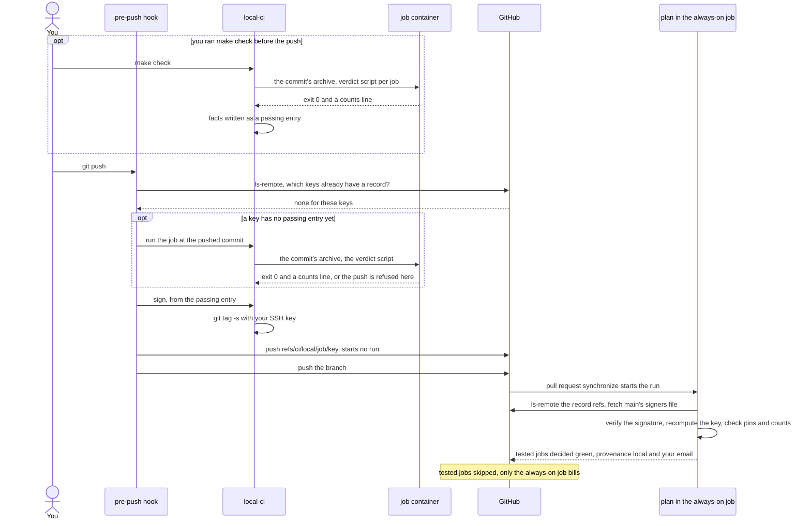
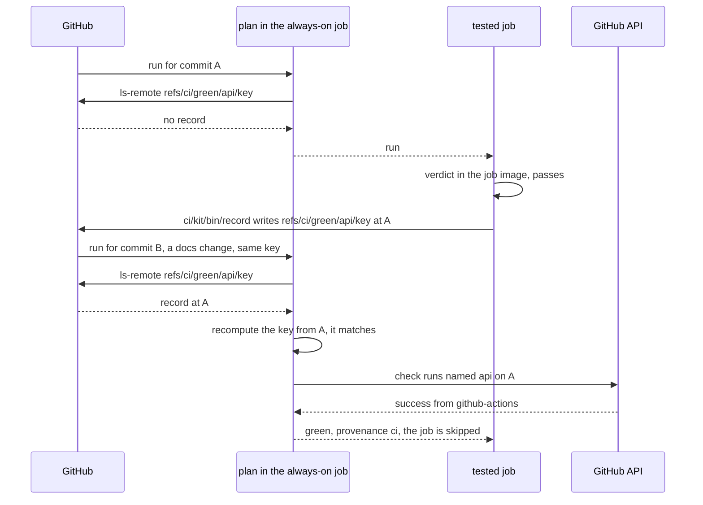

# quokka-ci-kit

Stop paying CI to re-run tests you already ran: a vendored kit for GitHub Actions that skips a job when its exact content already passed, in CI or, signed, on your own machine.

```text
        .-"""-.
       / .===. \       quokka-ci-kit
       \/ 6 6 \/       "already tested that tree,
       ( \___/ )        see you on Rottnest"
  ___ooo__V__ooo___
```

## The idea in three moves

1. **A verdict belongs to a tree, not a commit.** Each test job gets a KEY: a SHA-256 over exactly the paths its verdict depends on, at the commit under test. Equal content, equal key.
2. **A pass is recorded under its key, and the next run with that key skips the job.** CI writes `refs/ci/green/<job>/<key>` when a job passes. The first steps of every run look the keys up and skip what already passed. A documentation commit, a merge commit or an untouched tree then costs only the always-on job's minute.
3. **Your workstation may write the record too, signed.** A pre-push hook runs the job's own script, inside the same job image CI uses, and on a pass signs a block of facts with your SSH key and pushes it as `refs/ci/local/<job>/<key>`. CI trusts it only when the signature verifies against a signers file on protected main and the facts pass several checks. Once a week a scheduled run ignores every local record and runs on CI every job whose key at main's tip CI has not itself passed.

## The pieces

```text
  YOUR WORKSTATION                        GITHUB (origin)                        ACTIONS RUNNER
 +--------------------------------+      +-------------------------------+      +--------------------------------+
 | make check, git push           |      | refs/heads/<your branch>      |      | always-on job                  |
 |  .githooks/pre-push (shim)     |      | refs/heads/main (protected)   |      |  ci/kit/bin/plan:              |
 |  ci/kit/bin/pre-push           |      |   ci/allowed-signers ---------+----->|   keys, one ls-remote,         |
 |  ci/kit/bin/local-ci           |      |   ci/manifest (allow-list) ---+----->|   trust check per record,      |
 |   run  -> job container        |      |                               |      |   one decision per job,        |
 |          (ci/kit/bin/container)| push |                               |      |   summary table                |
 |   sign -> git tag -s (SSH key) |----->| refs/ci/local/<job>/<key> ----+----->|                                |
 |   push -> refs/ci/local/...    |      | refs/ci/green/<job>/<key> ----+----->| tested jobs, if: run           |
 |                                |      |            ^                  |      |  container run, then           |
 | ~/.ssh signing key (never in   |      |            +------------------+------|  ci/kit/bin/record on a pass   |
 | a container)                   |      | check runs (API) -------------+----->|  (green arm reads these)       |
 +--------------------------------+      +-------------------------------+      +--------------------------------+
```

Everything under `ci/kit/` is this repository's `kit/` directory, vendored byte for byte from a signed release. You write the rest: `ci/manifest`, one verdict script, a Dockerfile for the job image, and your workflow.

## A push through the hook



## The CI-green path



## Is this for you

It pays off when your pull requests spend real minutes on test jobs, or you wait on them, and your tests can run in a container on a laptop. You need all of these:

- **GitHub Actions**, with a **protected `main`**: pull requests only, **signed commits required**. List in the signers file the key that already signs your commits, and the local record adds no new key with new reach. The kit does not check that the two are the same key: whoever reviews a signer's line does, and `git log --show-signature` reading Good for that person's commits is the proof ([kit/README.md](kit/README.md) §7 step 10).
- **Docker** on every workstation and on the runner. A workstation needs Docker, git 2.34 or later, `ssh-keygen -Y`, bash 3.2 or later (the one macOS ships will do) and the standard Unix tools every macOS and Linux has; `make` as well when your check command is `make check`, as the example's is; and `python3`, with PyYAML for the workflow fence, wherever you run the two Python fences by hand. No tool a verdict uses comes from the workstation: those come from the job image.
- **Every job's verdict as one script** in your repository, which CI and a workstation run the same way. If checks live in workflow YAML, move them into the script first.
- **Every tool pinned** in a file the kit can read as data: a `toolchain` line in `go.mod`, an `.nvmrc`, or `readonly <NAME>_VERSION=` lines.
- **A Dockerfile for the job image**, `FROM` the kit's base, installing your tools at those pins.
- **Actions permissions that let a job write refs**: the jobs that record need `contents: write`, the always-on job also `checks: read`. The always-on job runs two Python fences, so the runner needs `python3` with PyYAML ([kit/README.md](kit/README.md) §5.5 has the one line that installs it where it is missing).

It is not for you if a job must test the host itself (its kernel, its sockets) and you want that job skipped locally: such a job can still use green records, but it runs only in CI.

## Quick start

The example repository, [quokka-ci-kit-example](https://github.com/aames/quokka-ci-kit-example), is every step below done once for a small Go and web project that records quokka sightings on Rottnest Island. Read its files beside these steps, and copy and rename them rather than writing from nothing. Each step ends with what is true when it is done.

1. **Check the host settings.** Protect `main`: pull requests only, signed commits required. Push a scratch ref such as `refs/ci/test` and confirm no workflow run starts. Open a scratch pull request whose required job is skipped by its `if:` and confirm it shows as passing. Confirm your Actions settings do not cap the token below `contents: write` and `checks: read`. *Done when* each of the four is read back on the host.
2. **Vendor the kit.** Put the release signer's line from [Releases and the release signer](#releases-and-the-release-signer) in `ci/KIT-SIGNERS`. At the top of your working copy, on `main`, run `bash <clone of this repository>/kit/bin/kit-update <tag>`. It verifies that the tag is a signed release, prints the fingerprint of each `ci/KIT-SIGNERS` line, and writes `ci/kit/` and `ci/KIT-VERSION`. *Done when* the printed fingerprint equals the published one (stop if it does not) and the two paths exist.
3. **Write your files, on a new branch.** `ci/manifest`, starting from the example's ([kit/README.md](kit/README.md) §3); `.githooks/pre-push`, copied from `ci/kit/hooks/pre-push.shim`; the verdict script, one arm per job ending in a counts line (the example's `ci/ci-job.sh`); `ci/image/Dockerfile` on the kit's base; a `Makefile` whose `check` target runs `bash ci/kit/bin/local-ci run --commit HEAD <your local jobs>`; `.github/workflows/ci.yml`, copied from the example's and renamed ([kit/README.md](kit/README.md) §5.5 gives it job by job); and `ci/allowed-signers` holding nothing but a comment line, so the file exists and trusts nobody yet. *Done when* every file is in your working copy.
4. **Commit, then check.** The checks read the commit, not your working copy, so commit first. Run `bash ci/kit/bin/check-manifest`, then `make check` once, then `bash ci/kit/bin/check-adapter <job>` for each local job but the kit job, `python3 ci/kit/bin/check-workflow` and `python3 ci/kit/bin/check-escaping-reads`. *Done when* each exits 0.
5. **Write the residual into your own documentation**, from [How trust works](#how-trust-works). *Done when* it is committed on the branch.
6. **Land it.** Merge `origin/main` into the branch, push with `--no-verify`, and open the pull request saying that its local records are refused until a signer is on `main`. *Done when* its run has executed every job in CI once, written the first green records, and merged.
7. **Add yourself as a signer.** Your line, `<your git user.email> namespaces="git" <key type> <public key>`, in `ci/allowed-signers`, in a pull request of its own. Its run executes on CI every job whose key covers that file, because `main`'s copy still trusts nobody until this merges. *Done when* it has merged.
8. **Turn the hook on.** `git config core.hooksPath .githooks`, `git config gpg.format ssh` and `git config user.signingkey <your public key>`. *Done when* `bash ci/kit/bin/check-prereqs` exits 0, `make check` passes, and you have read the facts it wrote.
9. **Push through the hook.** *Done when* the next pull request's summary shows `local: <your email>` beside each tested job.

The full procedure, with what proves each step done, is [kit/README.md](kit/README.md) §7.

## With an agent

An AI coding agent can do the quick start for you, and it asks you before anything that needs your word: the release fingerprint, the push, the branch protection.

- **Any agent** (Claude Code, Codex or another): paste [docs/adopt-with-an-agent.md](docs/adopt-with-an-agent.md) into a session in your repository.
- **Claude Code**: install the skill, [claude/skills/quokka-adopt](claude/skills/quokka-adopt/README.md), and ask it to adopt the kit.
- **Codex**: add one line to your `AGENTS.md`: `To adopt quokka-ci-kit or add a CI job, fetch https://raw.githubusercontent.com/aames/quokka-ci-kit/main/docs/adopt-with-an-agent.md and follow it.`

Once adopted, [docs/agents-section.md](docs/agents-section.md) is the section that tells an agent working in your repository how its CI works. `kit-init` ([docs/kit-init.md](docs/kit-init.md)) will write the files and that section for you once it is released, leaving the agent to check its work.

## How trust works

A **green record** is trusted when its key recomputes from the commit it names and that commit has a successful check run of the job from `github-actions`. That catches accidents, not malice. A **local record** is trusted only when its SSH signature verifies against the signers file **on main** (its contents never from the branch), its key recomputes, its tool versions equal the commit's pins, its counts are above zero and every skipped test leg is allow-listed on main; it is never trusted on a forced run or the weekly run. The weekly scheduled run ignores every local record and runs on CI each job whose key at main's tip CI has not itself passed. Write this residual into your own documentation, word for word, with the two facts [DESIGN.md](DESIGN.md) §3.4 states beside it:

> A local record proves that the holder of a key listed in main's signers file asserted the tree passed. It does not prove the tests ran. Anything running as that developer on that workstation, agent sessions included, can use the key, because it already signs their commits. The scheme bounds this (the signing step is reachable only after the job's own script exited 0; the facts let the plan refuse an off-pin tool, a run that counted nothing, an unlisted skip and a record moved to another tree; the weekly run on main's tip ignores every local record; the key is the one that already signs the developer's commits to protected main, where every change arrives by a reviewed pull request, so a falsely green tree reaches anything built from main only through a reviewed merge, as any tree does), and does not remove it.

If your project signs release artefacts, sign them with a key no workstation holds, and say so beside the residual: its bound assumes it.

The whole model, every control and its reason, is [DESIGN.md](DESIGN.md) §3. What the kit promises and does not is in [SECURITY.md](SECURITY.md).

## What it costs in minutes

GitHub Actions bills each job by the minute, rounded up, and bills nothing for a job skipped by its `if:`. The plan runs as the first steps of one always-on job, which runs on every run. So:

- a pull request whose tested jobs all carry trusted records bills **the always-on job only**, usually about a minute;
- a commit that changes no job's paths (documentation, say) bills the same, because every tested job's key equals one that CI or a listed signer already recorded;
- a merge to `main` re-uses the branch's records for every key `main` did not move, so merge `main` into your branch before its last push;
- each kit upgrade moves every adapter-run key once, so the next push runs those jobs on your workstation;
- the weekly independent check runs on CI each tested job whose key at `main`'s tip has no CI green record; after a week of local records that is usually every job, so budget one full run a week, on purpose;
- a pull request from a fork gains nothing from local records (its author holds no listed key) and writes no green records (the read-only token GitHub gives its run is refused, and the record step warns and passes), so every push of it runs on CI each job whose key no earlier record holds;
- adopting costs two full runs: the landing pull request runs every job on CI, and the pull request that adds the first signer runs on CI, again, every job whose key covers the signers file (in the example, every local job), because `main`'s file trusts nobody until it merges.

Your workstation pays instead: a cold job image build (several minutes, once per image key) and the tests themselves. The example's whole `make check` takes about three minutes cold, with both image builds, and well under a minute warm. A tested job that does run on CI takes your suite's own time plus the job image's build through the Actions cache, cold (several minutes) the first time and warm after; these documents give no measured figure for it, so bound each job's `timeout-minutes` by measuring it ([DESIGN.md](DESIGN.md) §11, "Job time bounds").

## Releases and the release signer

No release is tagged yet. The first will be `v1.0.0-rc.1`; until it exists `kit-update` has nothing it will accept, so nothing can be vendored. A release is a signed, annotated tag on this repository's protected `main` whose message's first line is `quokka-ci-kit <tag>` ([CONTRIBUTING.md](CONTRIBUTING.md) has how one is cut), and its [CHANGELOG.md](CHANGELOG.md) entry names the `kit/` tree it vendors.

The release signer's line for your `ci/KIT-SIGNERS`, in OpenSSH allowed-signers format:

```text
aames namespaces="git" ssh-ed25519 AAAAC3NzaC1lZDI1NTE5AAAAIGwn9FcjoALREhc3qxj9RcXrXtyInEMvEWu7lov/3wsC
```

Its fingerprint, as `ssh-keygen -lf` prints it:

```text
256 SHA256:Vwu8G5Eeo+oc6eRSJtjpGFVVMmUfMNrYpVMR0CfDjX8 no comment (ED25519)
```

At your first vendoring `kit-update` prints the fingerprint of each line of your `ci/KIT-SIGNERS`. Compare it with the one above as GitHub shows this page at the release's tag and, for a channel apart from the clone, ask through this repository's issues. If the two differ, do not vendor. The example repository's `ci/KIT-SIGNERS` carries a development key, not the release signer's, until it vendors the first release.

## Layout of this repository

```text
README.md            this page
DESIGN.md            the design: the trust model, every control and its reason, what to build and prove
CHANGELOG.md         one entry per release: moves keys, the kit/ tree hash, your actions
SECURITY.md          how to report a vulnerability, and what the kit promises
CONTRIBUTING.md      running the kit's tests, the bash 3.2 rule, cutting a release
LICENSE              MIT
docs/                adopting with an agent: the prompt and the AGENTS.md section
claude/skills/       the Claude Code skill that points at the prompt
kit/                 what you vendor at ci/kit/
  README.md          the command, manifest and adapter reference
  bin/               plan, record, prune, local-ci, pre-push, container, keys, kit-update, the checks
  lib/keys.sh        the key formula and the trust check, both arms
  image/             the base image's Dockerfile and its entry script
  hooks/             the pre-push shim you copy to .githooks/pre-push
  tests/             the kit's own proofs: run, image, plants
.github/workflows/   the kit's own CI
```

## Further reading

- [DESIGN.md](DESIGN.md): why, the trust model, the invariants, the pitfalls.
- [kit/README.md](kit/README.md): commands, the manifest, the adapter contract, versions, the adoption procedure.
- [CHANGELOG.md](CHANGELOG.md): releases.
- [SECURITY.md](SECURITY.md): reporting and promises.
- [CONTRIBUTING.md](CONTRIBUTING.md): working on the kit.
- [LICENSE](LICENSE): MIT.
