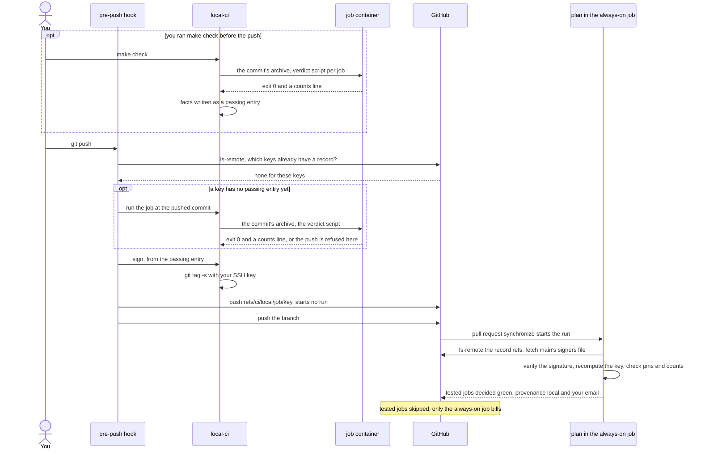
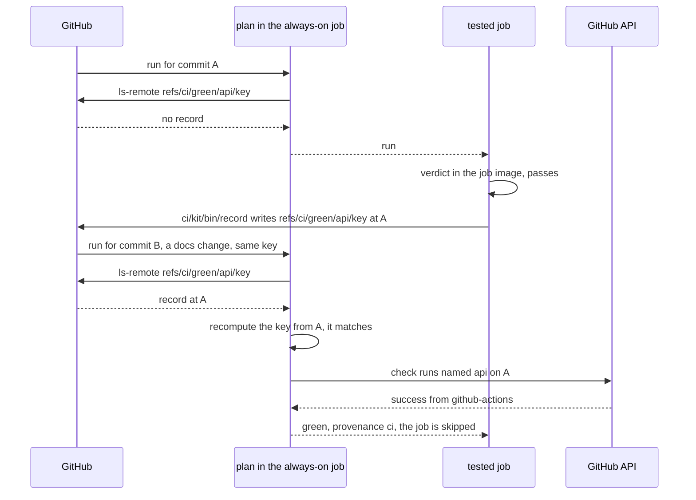

# quokka-ci-kit

Stop paying CI to re-run tests you have already run. quokka-ci-kit is a small set of scripts you vendor into a GitHub Actions repository. It skips a test job when the exact files that job depends on have already passed, either in CI or on your own machine, where a signed record of the run is pushed alongside your branch.

**Start here.** If you already have a repository, `kit-init` writes the files for you: see [QUICKSTART.md, Faster: kit-init](QUICKSTART.md#faster-kit-init). For a new repository made from our template, allow about 30 minutes: [QUICKSTART.md](QUICKSTART.md). If you would rather let an AI coding agent do the adoption (Claude Code, Codex or another), see [With an agent](#with-an-agent). The full adoption procedure, with a way to confirm each step is done, is [kit/README.md §7](kit/README.md).

```text
        .-"""-.
       / .===. \       quokka-ci-kit
       \/ 6 6 \/       "already tested that tree,
       ( \___/ )        see you on Rottnest"
  ___ooo__V__ooo___
```

## The idea, in three parts

1. **A test result belongs to a set of files, not to a commit.** Each test job gets a key: a SHA-256 hash over exactly the paths its result depends on, taken at the commit under test. If those files haven't changed, the key hasn't changed either.
2. **When a job passes, CI records the fact under that key, and later runs with the same key skip the job.** CI writes a git ref, `refs/ci/green/<job>/<key>`, when a job passes. The first thing every run does is look up each job's key and skip the jobs that have already passed. A documentation-only commit, a merge commit or a rebase of an untouched branch then costs you about a minute: the one job that always runs, which we call the always-on job.
3. **Your own machine can write a record too, if you sign it.** A pre-push hook runs the job's test script inside the same Docker image CI uses. If it passes, the hook signs a short block of facts about the run with your SSH key and pushes it as `refs/ci/local/<job>/<key>`. CI trusts that record only if the signature matches a key listed in a signers file on the protected `main` branch, and only if the facts pass several further checks. Once a week, a scheduled run ignores every local record and runs any job on `main` that CI hasn't passed itself.

## The pieces

```text
  YOUR WORKSTATION                        GITHUB (origin)                        ACTIONS RUNNER
 +--------------------------------+      +-------------------------------+      +--------------------------------+
 | make check, git push           |      | refs/heads/<your branch>      |      | always-on job                  |
 |  .githooks/pre-push (shim)     |      | refs/heads/main (protected)   |      |  ci/kit/bin/plan:              |
 |  ci/kit/bin/pre-push           |      |   ci/allowed-signers ---------+----->|   keys, one ls-remote,         |
 |  ci/kit/bin/local-ci           |      |   ci/manifest (allow-list) ---+----->|   trust check per record,      |
 |   run  -> job container        |      |                               |      |   one decision per job,        |
 |          (ci/kit/bin/container)| push |                               |      |   summary table                |
 |   sign -> git tag -s (SSH key) |----->| refs/ci/local/<job>/<key> ----+----->|                                |
 |   push -> refs/ci/local/...    |      | refs/ci/green/<job>/<key> ----+----->| tested jobs, if: run           |
 |                                |      |            ^                  |      |  container run, then           |
 | ~/.ssh signing key (never in   |      |            +------------------+------|  ci/kit/bin/record on a pass   |
 | a container)                   |      | check runs (API) -------------+----->|  (green arm reads these)       |
 +--------------------------------+      +-------------------------------+      +--------------------------------+
```

Everything under `ci/kit/` is a byte-for-byte copy of this repository's `kit/` directory, taken from a signed release. You write the rest: `ci/manifest`, one test script, a Dockerfile for the job image, and your workflow. The step that looks the keys up and decides which jobs can be skipped is called the plan. It runs first, inside the always-on job (`checks` in the example).

## A push through the hook



## The CI-green path



## Is this for you?

The kit pays off when your pull requests spend real minutes on test jobs, or you spend real time waiting for them, and your tests can run inside a container on a laptop. You will need all of the following:

- **GitHub Actions, with a protected `main` branch** that only accepts pull requests and requires signed commits. The key you already sign commits with is the one you list in the signers file, so the kit doesn't introduce a new key with powers your commit key lacks. The kit can't check that the two keys are the same; whoever reviews a new line in the signers file does that, by confirming that `git log --show-signature` shows a good signature on that person's commits ([kit/README.md](kit/README.md) §7, step 10).
- **Docker** on every workstation and on the runner. A workstation also needs git 2.34 or later, `ssh-keygen` with the `-Y` option, bash 3.2 or later (the one macOS ships is fine) and the usual Unix tools. Add `make` if your check command is `make check`, as the example's is, and `python3` with PyYAML if you want to run the two Python checks by hand. None of the tools your tests use come from the workstation; they all come from the job image.
- **One script per job that runs all of that job's checks**, committed to the repository, so that CI and a workstation run exactly the same thing. If some of your checks live in workflow YAML, move them into the script first.
- **Every tool pinned to a version** in a file the kit can read: a `toolchain` line in `go.mod`, an `.nvmrc`, a `.python-version`, or `readonly <NAME>_VERSION=` lines in a shell file.
- **A Dockerfile for the job image**, built `FROM` the kit's base image, that installs your tools at those pinned versions.
- **Actions permissions that let a job write refs.** The jobs that record results need `contents: write`, and the always-on job also needs `checks: read`. The always-on job runs two Python checks, so the runner needs `python3` with PyYAML ([kit/README.md](kit/README.md) §5.5 has the one-line install for a runner that lacks it).

The kit is not for you if a job has to test the host machine itself (its kernel, its sockets) and you want to skip that job on the strength of a local run. Such a job can still use CI's own records, but it only ever runs in CI.

## Quick start

**A repository you already have.** Vendor the kit, then let `kit-init` write the files. One command reads your directories and version pins and writes the manifest, the test script, the job image's Dockerfile (with checksums for each toolchain), the workflow, the hook, the `make check` target and a short CI section for coding agents. It commits them on your branch and runs the checks. Go, Node with vitest, and Python with pytest are written in full; anything else gets a stub that refuses to run until you fill it in. `kit-init` is available from `v1.1.0`. The steps are in [QUICKSTART.md, Faster: kit-init](QUICKSTART.md#faster-kit-init):

```sh
python3 ci/kit/bin/kit-init --project sightings --go api --node web --postgres api
make check
```

**A new repository.** [QUICKSTART.md](QUICKSTART.md) takes you from nothing to green CI in about 30 minutes, in nine numbered steps. It starts from the example repository, [quokka-ci-kit-example](https://github.com/aames/quokka-ci-kit-example), a small Go and web project that records quokka sightings on Rottnest Island, with the kit already vendored and every file written. On that page, click **Use this template**, then follow QUICKSTART.md.

Every step of adoption, each with a way to confirm it is done, is in [kit/README.md](kit/README.md) §7. What `kit-init` writes, and why, is in [docs/kit-init.md](docs/kit-init.md).

## With an agent

An AI coding agent can adopt the kit for you. It vendors the kit, runs `kit-init` with a flag for each language it finds in your repository, reads what was written, and runs the checks and `make check`. It asks you before doing anything that needs your say-so: confirming the release fingerprint, pushing, and changing branch protection.

- **Any agent** (Claude Code, Codex or another): paste [docs/adopt-with-an-agent.md](docs/adopt-with-an-agent.md) into a session in your repository.
- **Claude Code**: install the skill in [claude/skills/quokka-adopt](claude/skills/quokka-adopt/README.md) and ask it to adopt the kit.
- **Codex**: add one line to your `AGENTS.md`: `To adopt quokka-ci-kit or add a CI job, fetch https://raw.githubusercontent.com/aames/quokka-ci-kit/main/docs/adopt-with-an-agent.md and follow it.`

`kit-init` also writes a short section into your `AGENTS.md` and `CLAUDE.md` telling any agent that works in your repository how its CI works: run `make check` before pushing, and never edit `ci/kit/`. The text lives in one place, [kit/templates/agents/section.md](kit/templates/agents/section.md). [docs/agents-section.md](docs/agents-section.md) explains how to add it to a repository that adopted the kit by hand.

## How trust works

A **green record** is one that CI wrote. The plan trusts it when two things hold: the key in the ref's name can be recomputed from the commit the ref points at, and that commit has a successful check run for the job from `github-actions`. This catches accidents, not deliberate abuse.

A **local record** is one that your machine signed. The plan trusts it only when its SSH signature verifies against the signers file on `main` (never the branch's copy), its key can be recomputed, the tool versions it records match the commit's pins, its test counts are above zero, and any skipped test leg is on an allow-list kept on `main`. A local record is never trusted on a forced run or on the weekly run. The weekly scheduled run ignores every local record and runs, on CI, each job on `main` that CI hasn't passed itself.

Copy the paragraph below into your own documentation, word for word, together with the two further facts [DESIGN.md](DESIGN.md) §3.4 lists after it. It says what a local record does and doesn't prove (DESIGN.md calls this the residual). A project that leaves that unsaid ends up arguing about it at every review.

> A local record proves that the holder of a key listed in main's signers file asserted the tree passed. It does not prove the tests ran. Anything running as that developer on that workstation, agent sessions included, can use the key, because it already signs their commits. The scheme bounds this (the signing step is reachable only after the job's own script exited 0; the facts let the plan refuse an off-pin tool, a run that counted nothing, an unlisted skip and a record moved to another tree; the weekly run on main's tip ignores every local record; the key is the one that already signs the developer's commits to protected main, where every change arrives by a reviewed pull request, so a falsely green tree reaches anything built from main only through a reviewed merge, as any tree does), and does not remove it.

If your project signs release artefacts, sign them with a key that no workstation holds, and say so next to the paragraph. The argument above depends on it.

The whole model, every control and the reason for it, is in [DESIGN.md](DESIGN.md) §3. What the kit does and doesn't promise is in [SECURITY.md](SECURITY.md).

## What it costs in minutes

GitHub Actions bills each job by the minute, rounded up, and bills nothing for a job skipped by its `if:` condition. The plan runs as the first steps of the always-on job, which runs on every push. So:

- a pull request whose test jobs all have trusted records bills **only the always-on job**, usually about a minute;
- a commit that changes none of the paths any job depends on (documentation, say) bills the same, because every job's key already has a record, from CI or from a listed signer;
- a merge to `main` reuses the branch's records for every key that `main` hasn't changed, so merge `main` into your branch before its last push;
- each kit upgrade changes every job's key once, so the next push runs those jobs on your workstation;
- the weekly check runs, on CI, each job whose key at the tip of `main` has no record written by CI. After a week of local records that is usually every job, so budget for one full run a week. That is deliberate;
- a pull request from a fork gains nothing from local records (its author has no listed key) and writes no green records (GitHub gives a fork's run a read-only token, so the record step warns and carries on), so every push to it runs each job that no earlier record covers;
- adopting the kit costs two full runs: the pull request that adds the kit runs every job in CI, and the pull request that adds your first signer runs every job whose key covers the signers file (in the example, every local job), because `main`'s copy of that file trusts nobody until the second one merges.

Your workstation pays instead: a cold build of the job image (several minutes, once per image key) and the tests themselves. The example's whole `make check` takes about three minutes cold, including both image builds, and well under a minute warm. A test job that does run in CI takes as long as your suite plus the image build through the Actions cache: several minutes cold the first time, and much less once the cache is warm. We give no measured figure for that, so set each job's `timeout-minutes` by measuring it ([DESIGN.md](DESIGN.md) §11, "Job time bounds").

## Releases and the release signer

The current release is `v1.2.0`. A release is a signed, annotated tag on this repository's protected `main` branch. The first line of the tag message is `quokka-ci-kit <tag>` ([CONTRIBUTING.md](CONTRIBUTING.md) explains how a release is cut), and the release's [CHANGELOG.md](CHANGELOG.md) entry gives the hash of the `kit/` tree it contains.

This is the release signer's line for your `ci/KIT-SIGNERS` file, in OpenSSH allowed-signers format:

```text
aames namespaces="git" ssh-ed25519 AAAAC3NzaC1lZDI1NTE5AAAAIGwn9FcjoALREhc3qxj9RcXrXtyInEMvEWu7lov/3wsC
```

And its fingerprint, as `ssh-keygen -lf` prints it:

```text
256 SHA256:Vwu8G5Eeo+oc6eRSJtjpGFVVMmUfMNrYpVMR0CfDjX8 no comment (ED25519)
```

The first time you vendor the kit, `kit-update` prints the fingerprint of each line in your `ci/KIT-SIGNERS`. Compare it with the one above, as GitHub shows it on this page at the release's tag. If you would like to confirm it through a channel other than the clone itself, ask in this repository's issues. If the two differ, don't vendor. The example repository vendors this release, and its `ci/KIT-SIGNERS` carries this line.

## Layout of this repository

```text
README.md            this page
DESIGN.md            the design: the trust model, every control and why it exists, what to build and prove
CHANGELOG.md         one entry per release: whether keys change, the kit/ tree hash, what you need to do
SECURITY.md          how to report a vulnerability, and what the kit promises
CONTRIBUTING.md      running the kit's tests, the bash 3.2 rule, cutting a release
LICENSE              MIT
docs/                the kit-init specification; adopting with an agent (the prompt and the AGENTS.md section)
claude/skills/       the Claude Code skill that points at that prompt
kit/                 what you vendor at ci/kit/
  README.md          the reference for the commands, the manifest and the test script
  bin/               plan, record, prune, local-ci, pre-push, container, keys, kit-update, kit-init, the checks
  lib/keys.sh        the key formula and the trust check, for both kinds of record
  image/             the base image's Dockerfile and its entry script
  hooks/             the pre-push shim you copy to .githooks/pre-push
  templates/         what kit-init writes into your repository
  tests/             the kit's own tests: run, image, plants
.github/workflows/   the kit's own CI
```

## Further reading

- [DESIGN.md](DESIGN.md): why the kit exists, the trust model, the invariants, the pitfalls we met along the way.
- [kit/README.md](kit/README.md): the commands, the manifest, the test script's contract, versions, the adoption procedure.
- [CHANGELOG.md](CHANGELOG.md): releases.
- [SECURITY.md](SECURITY.md): reporting a vulnerability, and what the kit promises.
- [CONTRIBUTING.md](CONTRIBUTING.md): working on the kit.
- [LICENSE](LICENSE): MIT.
